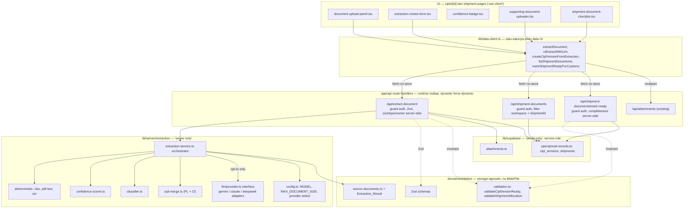
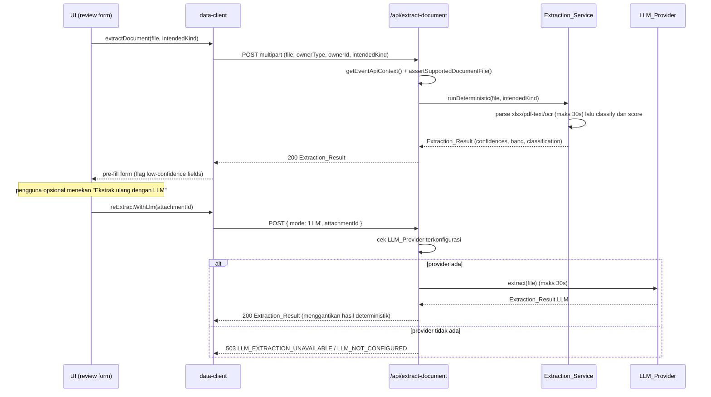

# Design Document — Customs Document Extraction

## Overview

Fitur ini menambahkan ekstraksi dokumen pabean dua lapis ke pipeline `CIPL → Shipment →
CustomsJob`. Tujuannya: pengguna mengunggah dokumen, sistem mengisi form otomatis, pengguna cukup
mengoreksi — bukan mengetik dari nol.

Dua lapis ekstraksi:

- **Lapis 1 — `Deterministic_Extraction` (tanpa LLM).** Dijalankan lebih dulu untuk setiap
  `Extractable_Document`. Terdiri atas parser XLSX, parser teks PDF (text-layer), dan OCR untuk PDF
  hasil pindaian. Menghasilkan `Extraction_Result` beserta `Confidence_Score` per field dan agregat
  per dokumen, plus pita keyakinan `LOW_CONFIDENCE | MEDIUM_CONFIDENCE | HIGH_CONFIDENCE`.
  (Requirement 2)
- **Lapis 2 — `LLM_Extraction` (opsional, opt-in, selalu tersedia).** Pilihan eksplisit
  `Ekstrak ulang dengan LLM` yang **tidak pernah** dipicu otomatis dan **tidak** diatur oleh
  confidence. Tersedia untuk setiap `Extractable_Document` selama ada `LLM_Provider` terkonfigurasi,
  melalui abstraksi provider (`GEMINI | CLAUDE | DEEPSEEK | ...`). (Requirement 3)

Ruang lingkup ekstraksi terbatas pada `Extractable_Document`: CIPL (`CIPL_COMBINED`, `PACKING_LIST`,
`COMMERCIAL_INVOICE`) dan `Transport_Document` (`BILL_OF_LADING`, `AIR_WAYBILL`). Dokumen lain adalah
`SUPPORTING_DOCUMENT` — hanya diunggah dan disimpan sebagai attachment, tanpa ekstraksi, tanpa
klasifikasi ke jenis spesifik, tanpa opsi LLM, dengan label bebas (open-ended). (Requirement 1.11,
2.2, 4.4, 7.8)

Posisi dalam pipeline: hasil CIPL → persist sebagai `CiplVersion` immutable; hasil transport →
mengisi field `Shipment`. Satu shipment memiliki `Mandatory_Document_Set` = tepat satu CIPL + tepat
satu `Transport_Document`; kelengkapannya divalidasi di server sebelum shipment ditandai siap pabean
(`READY_FOR_CUSTOMS`). (Requirement 5, 7)

Fitur ini membangun di atas kode yang ada dan merepositori jalur LLM-only saat ini
(`lib/server/document-extraction.ts :: extractDocument`) menjadi satu adapter provider GEMINI di
belakang antarmuka `LLM_Provider`, dengan `Deterministic_Extraction` sebagai jalur default.

### Keputusan desain utama

| Keputusan | Rasional | Requirement |
|---|---|---|
| Lapis deterministik dijalankan lebih dulu, LLM hanya opt-in | Hasil cepat, dapat diprediksi, hemat biaya; kontrol penuh di tangan pengguna | 2.1, 3.1, 3.3 |
| LLM provider-agnostic di balik antarmuka `LLM_Provider` | `LLM_PROVIDER`/`LLM_API_KEY` memilih provider; hindari kunci Gemini-only | 3.4, 3.5, 9.1 |
| `Extraction_Result` sebagai tipe beranotasi confidence terpisah dari tipe storage | `domain/**` harus bebas `Blob`/`File`; tipe storage (`JobInvoiceExtraction`/`JobTransportExtraction`) tidak dimutasi | 2.6, 9 (steering data-access) |
| Endpoint ekstraksi khusus, bukan proxy `/api/operational-records` | Butuh klasifikasi, merge PL+CI, validasi invariant server-side, akses provider LLM | 5.6, 5.7 (steering data-access) |
| Validasi invariant dipanggil dari Route_Handler, bukan hanya data-client | Menutup celah bypass `/api/operational-records` langsung | 5.6, 5.7 (steering pitfalls) |
| `SUPPORTING_DOCUMENT` disimpan via attachment `kind` sebagai label bebas | Jenis baru tanpa perubahan skema | 1.11, 4.4 |
| Konstanta `MODEL` + `MAX_DOCUMENT_SIZE` dipusatkan | Menghapus duplikasi hardcoded di 3 tempat | steering pitfalls |

### Dependensi baru (server-only)

Stack belum punya parser teks PDF maupun OCR. Keduanya **penambahan baru** dan **hanya dipakai di
`lib/server/`**:

- **Parser teks PDF**: `pdfjs-dist` (ekstraksi text-layer; sudah dipakai luas, maintained, pure JS).
- **OCR**: `tesseract.js` (OCR WASM, tanpa binary sistem; batas waktu 30 detik per dokumen).
- `xlsx` sudah menjadi dependency — dipakai kembali untuk parser XLSX.

Catatan: keduanya harus di-pin versi eksak (steering tech), diimpor hanya dari modul bertanda
`import 'server-only'`, dan tidak boleh bocor ke bundel browser (Requirement 9.1, 9.2).

---

## Architecture

Alur satu arah mengikuti steering data-access: komponen client → `@/lib/data-client` →
`fetch('/api/...', { cache: 'no-store' })` → Route_Handler (guard auth + Zod) → modul `server-only` →
Postgres/Storage. Tidak ada Server Action untuk mutasi; setelah mutasi, komponen refetch `list*`/
`get*` lalu `setState`.



### Di mana guard, Zod, dan invariant berada

- **Auth guard**: setiap Route_Handler memakai `getEventApiContext()` (dari `lib/supabase/event-api.ts`)
  di dalam `try/catch` dan mengembalikan `eventApiFailure(error)`. `getEventApiContext` melempar
  `'Autentikasi diperlukan.'` saat tidak ada sesi; `eventApiFailure` memetakan pesan itu ke 401.
  (Requirement 1.2, 7.7, 9.4)
- **Zod**: parsing input (`ownerType`, `ownerId`, `classification`, `kind`, body save CIPL,
  body mark-ready) dilakukan di Route_Handler memakai skema dari `domain/exhibition/validation.ts`.
  (Requirement 6.5, 6.6)
- **Validasi tipe/ukuran/keberadaan file**: dilakukan di server di Route_Handler (via
  `assertSupportedDocumentFile` + pengecekan `ownerType`/`ownerId`), tidak bergantung pada browser.
  (Requirement 1.8, 2.10, 8.5, 8.6)
- **Invariant bisnis**: `validateCiplVersionReady` dan `validateShipmentAllocation` dipanggil **dari
  Route_Handler** sebelum persist, menutup celah bypass `/api/operational-records`. (Requirement 5.6,
  5.7; steering pitfalls)

### Alur ekstraksi (sequence)



---

## Components and Interfaces

### Modul server-only: `lib/server/extraction/*`

Semua file diawali `import 'server-only'`. Konstanta model dan batas ukuran dipusatkan untuk
menghapus duplikasi yang disebut di steering pitfalls.

**`lib/server/extraction/config.ts`**

```ts
import 'server-only'

export const MAX_DOCUMENT_SIZE = 10 * 1024 * 1024 // 10.485.760 byte (R1.6, R8.5)
export const EXTRACTION_TIMEOUT_MS = 30_000 // batas OCR & LLM per dokumen (R2.5, R3.6, R9.7)
export const CONFIDENCE_THRESHOLD = 0.7 // hanya menandai review, TIDAK mengatur opsi LLM (R4.6, R6.3)

// Pita keyakinan agregat (R2.9)
export const CONFIDENCE_BANDS = { LOW: 0.5, MEDIUM: 0.8 } as const

export type LlmProviderId = 'GEMINI' | 'CLAUDE' | 'DEEPSEEK'
// Model per provider dipusatkan di sini (menggantikan 'gemini-3.5-flash-lite' yang di-hardcode)
export const LLM_MODELS: Record<LlmProviderId, string> = {
  GEMINI: 'gemini-3.5-flash-lite',
  CLAUDE: 'claude-3-5-haiku-latest',
  DEEPSEEK: 'deepseek-chat',
}

/** Membaca LLM_PROVIDER + LLM_API_KEY dari env (server-only). null jika tidak terkonfigurasi. */
export function configuredLlmProvider(): { id: LlmProviderId; apiKey: string } | null
```

**`lib/server/extraction/errors.ts`** — memperluas `DocumentExtractionError` yang ada, menambah kode
error terstruktur.

```ts
import 'server-only'

export type ExtractionErrorCode =
  | 'UNREADABLE_DOCUMENT'        // 400
  | 'UNSUPPORTED_FILE_TYPE'      // 400
  | 'FILE_TOO_LARGE'            // 413
  | 'OCR_FAILED'                // 502
  | 'LLM_EXTRACTION_TIMEOUT'    // 503
  | 'LLM_EXTRACTION_FAILED'     // 503
  | 'LLM_NOT_CONFIGURED'        // 503
  | 'LLM_EXTRACTION_UNAVAILABLE'// 503
  | 'EXTRACTION_SERVICE_UNAVAILABLE' // 503

export class DocumentExtractionError extends Error {
  constructor(
    message: string,              // pesan bahasa Indonesia (R8.*)
    readonly status: 400 | 413 | 502 | 503,
    readonly code: ExtractionErrorCode,
  ) { super(message) }
}
```

**`lib/server/extraction/file-guard.ts`**

```ts
import 'server-only'
// Dipindah & dipakai ulang dari document-extraction.ts; melempar DocumentExtractionError
// UNSUPPORTED_FILE_TYPE (400) dan FILE_TOO_LARGE (413). (R8.5, R8.6)
export function assertSupportedDocumentFile(file: File): void
export function isPdf(file: File): boolean
export function isSpreadsheet(file: File): boolean
```

**`lib/server/extraction/deterministic/xlsx-parser.ts`**

```ts
import 'server-only'
import type { ParsedDocument } from './parsed-document'
// XLSX.utils.sheet_to_csv → teks terstruktur per sheet, lalu field extractor. (R2.3)
export function parseSpreadsheet(file: File): Promise<ParsedDocument>
```

**`lib/server/extraction/deterministic/pdf-text-parser.ts`**

```ts
import 'server-only'
import type { ParsedDocument } from './parsed-document'
// pdfjs-dist: ekstrak text-layer. Mengembalikan { hasTextLayer: false } bila PDF pindaian. (R2.4)
export function parsePdfTextLayer(file: File): Promise<ParsedDocument & { hasTextLayer: boolean }>
```

**`lib/server/extraction/deterministic/ocr.ts`**

```ts
import 'server-only'
import type { ParsedDocument } from './parsed-document'
// tesseract.js dengan batas waktu EXTRACTION_TIMEOUT_MS. Melempar OCR_FAILED (502) saat gagal/kosong,
// atau DocumentExtractionError timeout. (R2.5, R8.2)
export function runOcr(file: File): Promise<ParsedDocument>
```

**`lib/server/extraction/confidence-scorer.ts`**

```ts
import 'server-only'
import type { ConfidenceBand, ConfidenceMap } from '@/domain/exhibition/source-documents'
// Menghitung confidence per field (kualitas parse, keterisian, kecocokan pola tanggal/angka/HS code)
// dan agregat. (R2.6, R2.8, R2.9)
export function scoreFields(fields: Record<string, unknown>): ConfidenceMap
export function aggregateConfidence(map: ConfidenceMap): number        // 0.00–1.00
export function bandForScore(aggregate: number): ConfidenceBand         // LOW/MEDIUM/HIGH
```

**`lib/server/extraction/classifier.ts`**

```ts
import 'server-only'
import type { DocumentClassification } from '@/domain/exhibition/source-documents'
// Total: SELALU mengembalikan tepat satu nilai dari himpunan tertutup. (R4.1)
// Memakai heuristik deterministik (header kolom, kata kunci, struktur) untuk lapis deterministik.
export function classifyDocument(parsed: ParsedDocument, intendedKind: IntendedKind): DocumentClassification
```

**`lib/server/extraction/cipl-merge.ts`**

```ts
import 'server-only'
import type { CiplMergeInput, CiplMergeResult } from '@/domain/exhibition/source-documents'
// Menggabungkan satu PACKING_LIST + satu COMMERCIAL_INVOICE. Normalisasi deskripsi:
// collapse whitespace → satu spasi, case-insensitive. Padankan baris by (normDescription, quantity).
// Nilai komersial diambil dari invoice. Baris tak terpadankan → reject. (R5.2, R5.3, R5.4)
export function mergePackingListAndInvoice(input: CiplMergeInput): CiplMergeResult
```

**`lib/server/extraction/llm/provider.ts`** — antarmuka provider-agnostic.

```ts
import 'server-only'
import type { Extraction_Result } from '@/domain/exhibition/source-documents'

export interface LlmProvider {
  readonly id: LlmProviderId
  extract(file: File): Promise<Extraction_Result> // batas waktu EXTRACTION_TIMEOUT_MS (R3.6)
}

// Memilih adapter berdasar configuredLlmProvider(); null bila tidak terkonfigurasi. (R3.4, R3.5, R8.7)
export function resolveLlmProvider(): LlmProvider | null
```

**`lib/server/extraction/llm/gemini-adapter.ts`** — `extractDocument` lama direposisi ke sini
sebagai `GeminiProvider implements LlmProvider`, memakai `geminiDocumentInput` dan `MODEL` dari
`config.ts`. Adapter `claude-adapter.ts` dan `deepseek-adapter.ts` mengikuti antarmuka yang sama.

**`lib/server/extraction/extraction-service.ts`** — orkestrator.

```ts
import 'server-only'
import type { Extraction_Result } from '@/domain/exhibition/source-documents'

// Lapis 1: deterministik. Memilih parser berdasar tipe & keberadaan text-layer; skor; klasifikasi.
export function runDeterministicExtraction(file: File, intendedKind: IntendedKind): Promise<Extraction_Result>

// Lapis 2: LLM. Dipanggil HANYA bila mode === 'LLM'; melempar LLM_NOT_CONFIGURED bila provider null.
export function runLlmExtraction(file: File): Promise<Extraction_Result>
```

### Domain: `domain/exhibition/source-documents.ts` (tambahan, storage-agnostic)

Tipe `JobInvoiceExtraction`/`JobTransportExtraction` yang ada **tidak dimutasi**. Ditambahkan tipe
`Extraction_Result` beranotasi confidence yang membungkus nilai + peta confidence. Tidak ada
`Blob`/`File`.

```ts
export type DocumentClassificationType =
  | 'CIPL_COMBINED' | 'PACKING_LIST' | 'COMMERCIAL_INVOICE'
  | 'BILL_OF_LADING' | 'AIR_WAYBILL'
  | 'SUPPORTING_DOCUMENT' | 'UNREADABLE'

export type ConfidenceBand = 'LOW_CONFIDENCE' | 'MEDIUM_CONFIDENCE' | 'HIGH_CONFIDENCE'

/** Peta confidence per-field; key adalah dot-path field di invoice/transport. Nilai 0.00–1.00. */
export type ConfidenceMap = Record<string, number>

export type DocumentClassification = {
  documentType: DocumentClassificationType
  confidence: number // 0.00–1.00
  needsUserConfirmation: boolean // true bila confidence < CONFIDENCE_THRESHOLD (R4.6)
  rationale: string | null
}

export type ExtractionMethod = 'DETERMINISTIC' | 'LLM'

export type Extraction_Result = {
  method: ExtractionMethod
  classification: DocumentClassification
  invoice: JobInvoiceExtraction | null
  transport: JobTransportExtraction | null
  fieldConfidence: ConfidenceMap     // per field (R2.6)
  aggregateConfidence: number        // 0.00–1.00 (R2.6, R2.8)
  band: ConfidenceBand               // LOW/MEDIUM/HIGH (R2.9)
}

export type IntendedKind = 'CIPL' | 'TRANSPORT' | 'SUPPORTING'

export type CiplMergeInput = { packingList: JobInvoiceExtraction; invoice: JobInvoiceExtraction }
export type CiplMergeResult =
  | { ok: true; merged: JobInvoiceExtraction }
  | { ok: false; unmatched: { source: 'PACKING_LIST' | 'COMMERCIAL_INVOICE'; description: string }[] }
```

### Domain: Zod schemas (`domain/exhibition/validation.ts`)

Input user di batas API diparse dengan Zod, `.strict()`, pesan bahasa Indonesia.

```ts
import { z } from 'zod'

export const extractDocumentSchema = z.object({
  ownerType: z.enum(['SHIPMENT', 'CIPL_VERSION'], {
    errorMap: () => ({ message: 'Tipe pemilik dokumen tidak didukung.' }), // R1.3
  }),
  ownerId: z.string().trim().min(1, 'Pemilik dokumen tidak ditemukan.'),    // R1.4
  intendedKind: z.enum(['CIPL', 'TRANSPORT', 'SUPPORTING']),
  mode: z.enum(['DETERMINISTIC', 'LLM']).default('DETERMINISTIC'),          // R3.3
}).strict()

// Catatan: file (Blob) tidak diparse Zod; divalidasi via assertSupportedDocumentFile di route (R1.8).

export const supportingDocumentSchema = z.object({
  ownerType: z.enum(['SHIPMENT', 'CIPL_VERSION']),
  ownerId: z.string().trim().min(1, 'Pemilik dokumen tidak ditemukan.'),
  label: z.string().trim().max(120).optional(),                            // label bebas (R1.11)
}).strict()

// Save CIPL dari hasil ekstraksi (pre-fill form sudah dikoreksi pengguna). (R6.5, R6.6)
export const ciplVersionFromExtractionSchema = z.object({
  ciplId: z.string().trim().min(1, 'CIPL wajib dipilih.'),
  source: z.discriminatedUnion('kind', [
    z.object({ kind: z.literal('COMBINED'), attachmentId: z.string().trim().min(1) }),
    z.object({
      kind: z.literal('SPLIT'),
      packingListAttachmentId: z.string().trim().min(1),
      invoiceAttachmentId: z.string().trim().min(1),
    }),
  ]),
  items: z.array(z.object({
    description: z.string().trim().min(1, 'Deskripsi item wajib diisi.'),
    quantity: z.number().positive('Quantity harus positif.'),
    unit: z.string().trim().min(1, 'Unit wajib diisi.'),
    unitValue: z.number().nullable(),
    currency: z.string().trim().nullable(),
    grossWeightKg: z.number().nullable(),
    netWeightKg: z.number().nullable(),
    countryOfOrigin: z.string().trim().nullable(),
  })).min(1, 'Versi CIPL harus memiliki minimal satu item.'),
}).strict()

export const markShipmentReadySchema = z.object({
  shipmentId: z.string().trim().min(1, 'Shipment wajib dipilih.'),
}).strict()
```

### Route handlers (baru) — `app/api/**`

Semua menetapkan `export const runtime = 'nodejs'` dan `export const dynamic = 'force-dynamic'`,
memakai `getEventApiContext()` + `eventApiFailure()`, dengan error shape `{ error: '<pesan>' }`.
Karena butuh klasifikasi/merge/validasi invariant/akses LLM, ini route khusus — bukan proxy
`/api/operational-records`.

**`app/api/extract-document/route.ts`** — `POST` multipart.

- Guard: `getEventApiContext()` (401 bila tanpa sesi — R1.2).
- Parse field form; `extractDocumentSchema.parse(...)` (400 per field — R6.6).
- `assertSupportedDocumentFile(file)` → `UNSUPPORTED_FILE_TYPE` (400, R8.6) / `FILE_TOO_LARGE`
  (413, R8.5); `FILE_REQUIRED` (400) bila tak ada file (R1.7).
- Cek `ownerId` merujuk entity yang ada & milik workspace (server-side, filter `workspace_id`) →
  `OWNER_NOT_FOUND` (400, R1.4).
- `intendedKind === 'SUPPORTING'` → hanya `uploadAttachment` (tanpa ekstraksi), terima `label` bebas
  ke kolom `kind` (R1.11, R2.2, R4.4).
- `mode === 'DETERMINISTIC'` → `runDeterministicExtraction` (R2.1).
- `mode === 'LLM'` → bila `resolveLlmProvider()` null → 503 `LLM_NOT_CONFIGURED` /
  `LLM_EXTRACTION_UNAVAILABLE` (R3.5, R8.7), pertahankan hasil deterministik; jika ada → batas waktu
  30s → `LLM_EXTRACTION_TIMEOUT`/`LLM_EXTRACTION_FAILED` (503, R8.3, R8.4).
- Mengembalikan `Extraction_Result` (200). Tidak mempersist apa pun di sini (R6.4).

**`app/api/cipl-versions/route.ts`** — `POST` persist CIPL version dari hasil ekstraksi (setelah
pengguna menekan simpan).

- Guard + `ciplVersionFromExtractionSchema.parse`.
- Bila `source.kind === 'SPLIT'`: panggil `mergePackingListAndInvoice`; jika `ok:false` → 400
  pesan baris tak terpadankan (R5.4); kombinasi dokumen di luar (COMBINED) atau (PL+CI) → 400 pesan
  `CIPL membutuhkan Packing List dan Commercial Invoice, atau satu dokumen CIPL gabungan.` (R5.5).
- Bangun `CiplVersion` immutable dari items; panggil **`validateCiplVersionReady` (server-side)** dan
  **`validateShipmentAllocation`** bila ada alokasi terkait (R5.6); jika `ok:false` → 400 batal
  persist, pesan invariant (R5.7).
- Persist ke `cipl_versions` via `operational-records` (payload jsonb camelCase + kolom promosi
  konsisten — steering database). Tautkan `sourceDocument` attachment by id.

**`app/api/shipment-documents/route.ts`** — `GET ?shipmentId=`.

- Guard + filter server-side `workspace_id` + `shipmentId`; mengembalikan hanya baris dokumen milik
  shipment itu (tidak membaca seluruh tabel lalu memfilter di browser — R9.3). 401 `AUTHENTICATION_REQUIRED`
  bila tanpa sesi (R9.4).
- Mengembalikan daftar attachment + status kelengkapan `Mandatory_Document_Set`
  (`COMPLETE | INCOMPLETE`) + pesan CIPL/transport yang hilang (R7.2, R7.3, R7.4), supporting docs
  tidak memengaruhi kelengkapan (R7.8).

**`app/api/shipment-documents/mark-ready/route.ts`** — `POST`.

- Guard (401 R7.7) + `markShipmentReadySchema.parse`.
- Hitung kelengkapan **di server** (R7.6): jika tidak lengkap → 400 `MANDATORY_DOCUMENTS_INCOMPLETE`
  pesan `Dokumen wajib shipment belum lengkap: CIPL dan B/L atau AWB.` tanpa mengubah status (R7.5).
- Jika lengkap → set `Shipment.status = 'READY_FOR_CUSTOMS'`.

### Tambahan `lib/data-client.ts` (verb-first, `'use client'`)

```ts
export async function extractDocument(input: {
  file: File; ownerType: 'SHIPMENT' | 'CIPL_VERSION'; ownerId: string
  intendedKind: 'CIPL' | 'TRANSPORT' | 'SUPPORTING'
}): Promise<Extraction_Result>                              // POST /api/extract-document (DETERMINISTIC)

export async function reExtractWithLlm(input: {
  file: File; ownerType: 'SHIPMENT' | 'CIPL_VERSION'; ownerId: string
  intendedKind: 'CIPL' | 'TRANSPORT'
}): Promise<Extraction_Result>                              // POST /api/extract-document (mode LLM)

export async function uploadSupportingDocument(input: {
  ownerType: 'SHIPMENT' | 'CIPL_VERSION'; ownerId: string; label?: string; file: File
}): Promise<Attachment>                                     // POST /api/extract-document (SUPPORTING)

export async function createCiplVersionFromExtraction(
  input: CiplVersionFromExtractionInput): Promise<CiplVersion> // POST /api/cipl-versions

export async function listShipmentDocuments(
  shipmentId: string): Promise<ShipmentDocumentsView>       // GET /api/shipment-documents

export async function markShipmentReadyForCustoms(
  shipmentId: string): Promise<Shipment>                    // POST .../mark-ready
```

`id()` tetap memakai `crypto.randomUUID()` di browser; `attachmentMetadata()` tetap membuang
`content` sebelum persist. Validasi tipe/ukuran di browser dipertahankan untuk UX, tetapi
**validasi otoritatif ada di server** (R1.8).

### Komponen UI — `components/<kebab-case>.tsx`

- `components/document-upload-panel.tsx` — drop zone unggah, memilih `intendedKind`, memicu
  `extractDocument`. Memakai `PageSkeleton`/`finishLoadingAfterMinimum` (min 300ms) saat ekstraksi
  berlangsung (R9.6).
- `components/extraction-review-form.tsx` — pre-fill dari `Extraction_Result`, seluruh field
  editable (R6.1, R6.2); menampilkan tombol `Ekstrak ulang dengan LLM` yang selalu tampil untuk
  `Extractable_Document` dan dinonaktifkan dengan pesan bila provider tidak ada (R3.1, R3.4);
  simpan via `createCiplVersionFromExtraction`.
- `components/confidence-badge.tsx` — badge pita keyakinan + penanda field perlu ditinjau dengan
  `aria` (R6.3). Memakai mekanisme `vss:toast` bersama (bukan menyalin helper) untuk sukses/gagal.
- `components/supporting-document-uploader.tsx` — unggah dokumen pendukung dengan label teks bebas,
  tanpa pilihan jenis tertutup (R1.11).
- `components/shipment-document-checklist.tsx` — menampilkan `COMPLETE/INCOMPLETE` + pesan dokumen
  wajib yang hilang, tombol "Tandai siap pabean" → `markShipmentReadyForCustoms` (R7.2–7.5).

Titik pasang: halaman `app/(dashboard)/cipls/[id]/` (dan subrute `versions/new`, `shipments/new`,
`shipments/[shipmentId]/`). Komponen dipisah ke `components/` sesuai steering (hindari menambah
halaman monolit).

---

## Data Models

### `Extraction_Result` dan peta confidence

Didefinisikan di `domain/exhibition/source-documents.ts` (lihat Components). Ringkas:

- `fieldConfidence: ConfidenceMap` — `Record<string, number>` dengan key dot-path (mis.
  `invoice.invoiceNumber`, `invoice.items.0.quantity`, `transport.documentNumber`), nilai 0.00–1.00.
- `aggregateConfidence: number` — 0.00–1.00; 0.00 bila tak ada field terbaca (R2.8).
- `band: ConfidenceBand` — `LOW` `< 0.50`, `MEDIUM` `0.50..<0.80`, `HIGH` `>= 0.80` (R2.9).
- `classification.needsUserConfirmation` — `true` bila `classification.confidence <
  CONFIDENCE_THRESHOLD (0.70)` (R4.6). Ambang ini **tidak** mengatur opsi LLM.

### Enum klasifikasi

`DocumentClassificationType = CIPL_COMBINED | PACKING_LIST | COMMERCIAL_INVOICE | BILL_OF_LADING |
AIR_WAYBILL | SUPPORTING_DOCUMENT | UNREADABLE`. Ini **merekonsiliasi** `documentTypes` lama
(`BILL_OF_LADING, AIR_WAYBILL, COMMERCIAL_INVOICE, OTHER, UNREADABLE`): `OTHER` dihapus dan diganti
`SUPPORTING_DOCUMENT`; ditambah `CIPL_COMBINED` dan `PACKING_LIST`. (Requirement 4.1)

### Pemetaan `Extraction_Result` (invoice) → `CiplItem[]`

Untuk membuat `CiplVersion`. `CiplItem` berbeda field dari `JobInvoiceItem`, jadi pemetaan eksplisit:

| `CiplItem` (target) | Sumber `JobInvoiceItem` | Catatan |
|---|---|---|
| `id` | — | `crypto.randomUUID()` di data-client |
| `lineNumber` | `lineNumber` (fallback indeks+1) | wajib number |
| `description` | `description` | satu-satunya field non-null di sumber |
| `quantity` | `quantity` | wajib positif; kosong → form minta input (R6.1) |
| `unit` | `unit` | wajib terisi |
| `unitValue` | `unitPrice` | nilai komersial dari invoice |
| `currency` | `currency` (fallback `invoice.currency`) | |
| `grossWeightKg` | `grossWeightKg` | |
| `netWeightKg` | `netWeightKg` | |
| `countryOfOrigin` | `countryOfOrigin` | |
| `identifiers` | `itemCode`/`hsCode` → `[]` bila kosong | gabungan kode sebagai identifier |
| `intendedUse` | — | kosong; diisi manual |
| `intendedDisposal` | — | kosong; diisi manual |

Field `packageCount`/`packageType`/`lineTotal`/`hsCode` yang tak punya padanan `CiplItem` dibawa ke
form sebagai info/di-drop; tidak ada data diciptakan tanpa sumber (R6.1).

### Pemetaan `JobTransportExtraction` → field `Shipment`

| `Shipment` (target) | Sumber `JobTransportExtraction` | Catatan |
|---|---|---|
| `documentType` | klasifikasi: `BILL_OF_LADING`→`BL`, `AIR_WAYBILL`→`AWB` | (R4.3) |
| `documentNumber` | `documentNumber` | |
| `carrier` | `carrier` | |
| `shipper` | `shipper.name` | party → string nama |
| `consignee` | `consignee.name` | |
| `notifyParty` | `notifyParty.name` | |
| `origin` | `portOfLoading` (fallback `placeOfReceipt`) | |
| `destination` | `portOfDischarge` (fallback `placeOfDelivery`) | |
| `etaOrEtd` | `eta` (fallback `etd`) | |
| `shipmentMode` | derivasi dari `containers` (ada → `FCL`, kosong → `LCL`) atau null | |

Field transport lain (`vesselOrFlight`, `voyage`, berat, volume, containers) ditampilkan di form
review; yang tidak punya kolom `Shipment` tidak dipersist sebagai kolom tetapi dapat disimpan di
payload bila diperlukan nanti (di luar lingkup persist minimal fitur ini).

### Keputusan skema

- **`Attachment.mimeType` diperlebar.** Saat ini literal `'application/pdf'`. Fitur ini menerima
  Excel + supporting docs, jadi tipe diperlebar menjadi union:
  `'application/pdf' | 'application/vnd.ms-excel' |
  'application/vnd.openxmlformats-officedocument.spreadsheetml.sheet' | string`. Perubahan hanya pada
  tipe domain; tabel `attachments` sudah menyimpan `mime_type` sebagai teks bebas, jadi **tidak perlu
  migrasi DB**. (Requirement 1.5)
- **`attachments.kind` sebagai label supporting-document.** Kolom `kind` (teks bebas, sudah ada)
  menjadi rumah label `SUPPORTING_DOCUMENT`. Tidak ada enumerasi jenis, jenis baru tanpa perubahan
  skema. (Requirement 1.11, 4.4)
- **Tanpa tabel baru.** `cipl_versions`, `shipments`, `attachments` sudah ada dan ter-allowlist di
  `operationalTables`. Tidak ada migrasi baru yang dibutuhkan untuk fitur ini. Penomoran apa pun yang
  dibutuhkan mengikuti pola yang ada (hindari pola race read-modify-write counter — steering pitfalls).

---

## Correctness Properties

*Properti adalah karakteristik atau perilaku yang harus selalu benar di semua eksekusi valid sebuah
sistem — pernyataan formal tentang apa yang harus dilakukan sistem. Properti menjadi jembatan antara
spesifikasi yang dapat dibaca manusia dan jaminan kebenaran yang dapat diverifikasi mesin.*

Lingkup PBT di fitur ini adalah logika deterministik yang murni-ish: penilaian confidence,
klasifikasi, penggabungan PL+CI, dan kelengkapan dokumen. Interaksi UI, pemanggilan LLM, upload
storage, dan perilaku route handler diuji dengan unit/integration test (lihat Testing Strategy),
bukan PBT.

### Property 1: Confidence selalu dalam rentang [0,1]

*For all* dokumen ter-parse, setiap `Confidence_Score` per field pada `fieldConfidence` dan
`aggregateConfidence` yang dihasilkan `scoreFields`/`aggregateConfidence` harus bernilai di rentang
0.00 sampai 1.00 inklusif.

**Validates: Requirements 2.6**

### Property 2: Tidak ada field terbaca ⇒ agregat 0.00 dan LOW_CONFIDENCE

*For all* dokumen ter-parse yang tidak memiliki satu pun field terbaca, `aggregateConfidence` harus
sama dengan 0.00 dan `band` harus `LOW_CONFIDENCE`.

**Validates: Requirements 2.8**

### Property 3: Pita keyakinan cocok dengan ambang

*For all* skor agregat di rentang [0,1], `bandForScore` mengembalikan `LOW_CONFIDENCE` bila skor
`< 0.50`, `MEDIUM_CONFIDENCE` bila `0.50 <= skor < 0.80`, dan `HIGH_CONFIDENCE` bila `skor >= 0.80`.

**Validates: Requirements 2.9**

### Property 4: Klasifikasi bersifat total

*For all* dokumen ter-parse dan nilai `intendedKind`, `classifyDocument` mengembalikan tepat satu
nilai yang merupakan anggota himpunan tertutup `{CIPL_COMBINED, PACKING_LIST, COMMERCIAL_INVOICE,
BILL_OF_LADING, AIR_WAYBILL, SUPPORTING_DOCUMENT, UNREADABLE}`.

**Validates: Requirements 4.1**

### Property 5: Penandaan perlu konfirmasi sesuai ambang

*For all* hasil klasifikasi dengan `confidence` di rentang [0,1], `needsUserConfirmation` bernilai
`true` jika dan hanya jika `confidence < CONFIDENCE_THRESHOLD` (0.70).

**Validates: Requirements 4.6**

### Property 6: Penggabungan PL+CI mempertahankan nilai komersial dan mengonservasi kuantitas

*For all* pasangan `PACKING_LIST` dan `COMMERCIAL_INVOICE` yang seluruh barisnya dapat dipadankan
(berdasarkan deskripsi ternormalisasi dan kuantitas sama), hasil gabungan `ok:true` harus:
(a) mengambil nilai komersial (unitPrice/lineTotal/currency) setiap baris dari Commercial Invoice,
dan (b) jumlah kuantitas seluruh baris gabungan sama dengan jumlah kuantitas baris input — tidak ada
kuantitas yang diciptakan maupun dihilangkan.

**Validates: Requirements 5.2, 5.3**

### Property 7: Penggabungan bersifat idempoten

*For all* pasangan PL+CI yang dapat dipadankan, menjalankan normalisasi lalu penggabungan dua kali
menghasilkan `Extraction_Result` CIPL yang sama dengan sekali jalan — hasilnya stabil.

**Validates: Requirements 5.3**

### Property 8: Baris tak terpadankan menolak penggabungan

*For all* pasangan PL+CI yang memiliki setidaknya satu baris pada salah satu dokumen yang tidak dapat
dipadankan berdasarkan deskripsi ternormalisasi dan kuantitas, `mergePackingListAndInvoice`
mengembalikan `ok:false` beserta daftar baris tak terpadankan, dan tidak menghasilkan CIPL version.

**Validates: Requirements 5.4**

### Property 9: Kelengkapan mandatory adalah biconditional dan tak terpengaruh dokumen pendukung

*For all* himpunan dokumen yang tertaut pada shipment dan jumlah `SUPPORTING_DOCUMENT` berapa pun,
status kelengkapan bernilai `COMPLETE` jika dan hanya jika tepat satu dokumen CIPL dan tepat satu
`Transport_Document` hadir; menambah atau mengurangi `SUPPORTING_DOCUMENT` tidak mengubah status
kelengkapan.

**Validates: Requirements 7.1, 7.2, 7.8**

### Property 10: Himpunan status error ekstraksi terbatas

*For all* `DocumentExtractionError` yang dilempar Extraction_Service, nilai `status` adalah tepat satu
anggota himpunan `{400, 413, 502, 503}` dan `message` adalah string bahasa Indonesia tak kosong.

**Validates: Requirements 8.8**

---

## Error Handling

Semua error dikembalikan sebagai `{ error: '<pesan Indonesia>' }` dengan tepat satu status dari
himpunan `{400, 413, 502, 503}` untuk kondisi ekstraksi/unggah, plus `401` untuk otentikasi
(diturunkan dari `getEventApiContext` → `eventApiFailure`). `lib/data-client` membaca field `error`
dan melempar `Error` dengan pesan tersebut. Komponen menampilkan pesan sebagai toast gagal (kanan
bawah, 4 detik) tanpa mengubah nilai form (R6.8).

| Kode | Status | Pesan (Indonesia) | Dilempar di | Requirement |
|---|---|---|---|---|
| `UNAUTHENTICATED` / `AUTHENTICATION_REQUIRED` | 401 | `Autentikasi diperlukan.` | Route_Handler (`getEventApiContext`) | 1.2, 7.7, 9.4 |
| `UNSUPPORTED_OWNER_TYPE` | 400 | `Tipe pemilik dokumen tidak didukung.` | Route_Handler (Zod) | 1.3 |
| `OWNER_NOT_FOUND` | 400 | `Pemilik dokumen tidak ditemukan.` | Route_Handler | 1.4 |
| `FILE_REQUIRED` | 400 | `File dokumen wajib diunggah.` | Route_Handler | 1.7 |
| `UNSUPPORTED_FILE_TYPE` | 400 | `File harus berupa PDF atau Excel.` | Extraction_Service (`assertSupportedDocumentFile`) | 1.5, 8.6 |
| `FILE_TOO_LARGE` | 413 | `Ukuran dokumen melebihi batas 10 MB.` | Extraction_Service (`assertSupportedDocumentFile`) | 1.6, 8.5, 2.10 |
| `UNREADABLE_DOCUMENT` | 400 | `Dokumen tidak dapat dibaca. Coba unggah ulang atau gunakan dokumen lain.` | Extraction_Service (parser) | 8.1, 2.11 |
| `OCR_FAILED` | 502 | `Pemindaian teks dokumen gagal. Coba dokumen dengan kualitas lebih baik.` | Extraction_Service (OCR) | 8.2 |
| `ATTACHMENT_STORE_UNAVAILABLE` | 503 | `Gagal menyimpan dokumen. Silakan coba lagi.` | Route_Handler (`uploadAttachment`) | 1.10 |
| `LLM_NOT_CONFIGURED` | 503 | `Ekstraksi LLM tidak tersedia karena belum ada penyedia LLM yang dikonfigurasi.` | Route_Handler | 3.4, 8.7 |
| `LLM_EXTRACTION_UNAVAILABLE` | 503 | `Ekstraksi LLM tidak tersedia karena belum ada penyedia LLM yang dikonfigurasi.` | Route_Handler | 3.5 |
| `LLM_EXTRACTION_TIMEOUT` | 503 | `Ekstraksi LLM gagal. Coba lagi atau gunakan hasil deterministik.` | Route_Handler | 8.3 |
| `LLM_EXTRACTION_FAILED` | 503 | `Ekstraksi LLM gagal. Coba lagi atau gunakan hasil deterministik.` | Route_Handler | 3.7, 8.4 |
| `EXTRACTION_SERVICE_UNAVAILABLE` | 503 | `Layanan ekstraksi gagal. Coba lagi atau isi form manual.` | Route_Handler | 9.7, 4.7 |
| `MANDATORY_DOCUMENTS_INCOMPLETE` | 400 | `Dokumen wajib shipment belum lengkap: CIPL dan B/L atau AWB.` | Route_Handler (mark-ready) | 7.5 |
| `CIPL_MERGE_UNMATCHED` | 400 | pesan baris barang tak terpadankan | Route_Handler (`cipl-versions`) | 5.4 |
| `CIPL_COMBINATION_INVALID` | 400 | `CIPL membutuhkan Packing List dan Commercial Invoice, atau satu dokumen CIPL gabungan.` | Route_Handler | 5.5 |
| `ALLOCATION_INVARIANT_VIOLATED` | 400 | pesan dari `Validation<T>.issues` | Route_Handler (`validateShipmentAllocation`/`validateCiplVersionReady`) | 5.7 |
| `VALIDATION_ERROR` | 400 | pesan Zod spesifik per field | Route_Handler (Zod) | 6.6 |
| `UNREADABLE` (klasifikasi CIPL/transport) | — (UI) | `Dokumen tidak dapat dibaca. Unggah ulang dengan kualitas lebih baik atau isi form manual.` | UI dari `Extraction_Result` | 4.5 |

Prinsip: setiap jalur error membatalkan proses tanpa menyimpan artefak parsial — `uploadAttachment`
sudah menghapus objek bila penulisan metadata gagal (R1.10); ekstraksi tidak mempersist
`Extraction_Result` parsial (R2.11, R8.1); error LLM mempertahankan hasil deterministik yang ada
tanpa perubahan (R3.5, R3.7).

---

## Testing Strategy

Pendekatan ganda: unit test untuk contoh/edge/error, dan property-based test untuk properti
universal. `npx tsc --noEmit` harus tetap bersih; `npm run build` dijalankan untuk perubahan yang
menyentuh route/komponen.

### Property-based tests

- Library: **`fast-check`** dengan **`bun:test`** (`import { test, expect } from 'bun:test'`,
  `import fc from 'fast-check'`). PBT **tidak** diimplementasikan dari nol.
- Minimum **100 iterasi** per properti (`fc.assert(..., { numRuns: 100 })`).
- Setiap test diberi tag komentar: `// Feature: customs-document-extraction, Property {n}: {teks}`.
- Satu properti ⇒ satu property-based test. Pemetaan properti → file:

| Properti | File test |
|---|---|
| 1, 2, 3 | `lib/server/extraction/confidence-scorer.test.ts` |
| 4, 5 | `lib/server/extraction/classifier.test.ts` |
| 6, 7, 8 | `lib/server/extraction/cipl-merge.test.ts` |
| 9 | `domain/exhibition/mandatory-documents.test.ts` |
| 10 | `lib/server/extraction/errors.test.ts` |

### Unit & integration tests (bukan PBT)

- Route handler (`extract-document`, `cipl-versions`, `shipment-documents`, `mark-ready`): mock
  konteks + Extraction_Service; verifikasi status/kode/pesan untuk auth (401), tipe/ukuran/owner
  (400/413), LLM tidak terkonfigurasi (503 `LLM_NOT_CONFIGURED`), timeout/gagal LLM (503), dan
  kelengkapan (400 `MANDATORY_DOCUMENTS_INCOMPLETE`). Requirement 1.*, 3.*, 6.6, 7.5–7.7, 8.*.
- Parser deterministik: contoh fixture XLSX, PDF text-layer, dan PDF pindaian (OCR) — verifikasi
  klasifikasi dan field terekstrak untuk contoh nyata (R2.3–2.5).
- Pemetaan `invoice→CiplItem[]` dan `transport→Shipment`: unit test contoh.

### Registrasi script test (WAJIB)

File `*.test.ts` baru **tidak** berjalan otomatis — harus ditambahkan ke script `domain:test` di
`package.json` (steering tech). Daftarkan kelima path di tabel properti di atas plus test unit
pemetaan. Gaya baru memakai `bun:test`.

### Gate

- `npx tsc --noEmit` bersih (steering tech).
- `npm run domain:test` lulus.
- `npm run build` untuk perubahan route/komponen.

---

## Security, Performance, dan Accessibility

**Keamanan (Requirement 9.1, 9.2):**

- Seluruh pemanggilan kunci API provider LLM (`LLM_API_KEY`, dan `GEMINI_API_KEY` legacy di belakang
  adapter) hanya di modul bertanda `import 'server-only'` (`lib/server/extraction/**`). Tidak ada
  nilai kunci di bundel browser.
- Tidak ada prefix `NEXT_PUBLIC_` pada variabel rahasia apa pun (`LLM_API_KEY`,
  `SUPABASE_SERVICE_ROLE_KEY`). `app/**` (non-`api`) dan `components/**` tidak mengimpor
  `@/lib/supabase/*` maupun `@/lib/server/*` — hanya `@/lib/data-client`.
- `env` baru: `LLM_PROVIDER` (`GEMINI|CLAUDE|DEEPSEEK`) dan `LLM_API_KEY`; keduanya opsional —
  bila kosong, opsi LLM dinonaktifkan (R3.4). Didokumentasikan di `.env.example` tanpa
  `NEXT_PUBLIC_`.

**Performa (Requirement 9.3, 9.6):**

- `GET /api/shipment-documents` memfilter server-side berdasarkan `workspace_id` + `shipmentId`
  (workspace selalu `.eq('slug','default')`); tidak membaca seluruh tabel lalu memfilter di browser.
- OCR dan LLM dibatasi `EXTRACTION_TIMEOUT_MS` (30 detik) per dokumen (R2.5, R3.6, R9.7).
- UI ekstraksi memakai `PageSkeleton`/`finishLoadingAfterMinimum` dengan durasi tampil minimum
  300 ms agar tidak berkedip (R9.6).

**Aksesibilitas (Requirement 9.5, 6.3):**

- `aria-label` pada setiap kontrol interaktif (drop zone, tombol LLM, field review).
- Field confidence rendah diberi penanda `aria` (mis. `aria-describedby` ke teks "perlu ditinjau")
  sehingga terbaca pembaca layar (R6.3).
- Outline `focus-visible` global dipertahankan; animasi non-esensial dinonaktifkan saat
  `prefers-reduced-motion: reduce`.
- Toast sukses/gagal di kanan bawah viewport, tutup otomatis 4 detik, lewat mekanisme `vss:toast`
  bersama (impor helper, tidak menyalin) — R6.7, R6.8.

