# Implementation Plan: Customs Document Extraction

## Overview

Implementasi fitur ekstraksi dokumen pabean dua lapis untuk pipeline `CIPL → Shipment →
CustomsJob`. Urutan tugas dibangun bertahap tanpa dependensi maju: konstanta/konfigurasi/tipe lebih
dulu, lalu logika murni deterministik (parser, confidence scorer, classifier, PL+CI merger) beserta
test-nya, kemudian abstraksi provider LLM + adapter, skema Zod, route handler, fungsi data-client,
komponen UI, pemasangan ke halaman `cipls/[id]`, dan verifikasi akhir.

Referensi: `requirements.md` (acceptance criteria) dan `design.md` (modul layout, Correctness
Properties, Testing Strategy). Teks untuk pengguna berbahasa Indonesia; identifier, enum, dan kode
error berbahasa Inggris `SCREAMING_SNAKE_CASE`.

## Tasks

- [x] 1. Buat konfigurasi terpusat dan kode error ekstraksi (server-only)
  - Buat `lib/server/extraction/config.ts` diawali `import 'server-only'` dengan konstanta terpusat:
    `MAX_DOCUMENT_SIZE` (10.485.760 byte), `EXTRACTION_TIMEOUT_MS` (30_000), `CONFIDENCE_THRESHOLD`
    (0.7), `CONFIDENCE_BANDS` (`{ LOW: 0.5, MEDIUM: 0.8 }`), tipe `LlmProviderId`
    (`GEMINI | CLAUDE | DEEPSEEK`), peta `LLM_MODELS`, dan `configuredLlmProvider()` yang membaca
    `LLM_PROVIDER` + `LLM_API_KEY` dari env (null bila tidak ada).
  - Buat `lib/server/extraction/errors.ts` diawali `import 'server-only'` dengan tipe
    `ExtractionErrorCode` dan kelas `DocumentExtractionError` berisi `message` (Indonesia),
    `status` (`400 | 413 | 502 | 503`), dan `code`.
  - Tujuan: menghapus pitfall `MODEL`/`MAX_DOCUMENT_SIZE` yang di-hardcode di 3 tempat dengan
    memusatkannya di `config.ts`.
  - _Requirements: 1.6, 2.5, 3.6, 4.6, 6.3, 8.8, 9.7_

- [x] 2. Tambahkan dependensi server-only yang di-pin eksak
  - Tambahkan `pdfjs-dist` (parser text-layer PDF) dan `tesseract.js` (OCR WASM) ke `dependencies`
    `package.json` dengan versi eksak (tanpa `^`/`~`), konsisten dengan gaya pin di repo.
  - Konfirmasi `xlsx` sudah ada dan dipakai kembali untuk parser XLSX; konfirmasi `fast-check` sudah
    ada untuk PBT.
  - Catatan: keduanya hanya boleh diimpor dari modul bertanda `import 'server-only'` dan tidak boleh
    bocor ke bundel browser.
  - _Requirements: 2.3, 2.4, 2.5, 9.1, 9.2_

- [x] 3. Tambahkan tipe domain ekstraksi (storage-agnostic, tanpa Blob/File)
  - Di `domain/exhibition/source-documents.ts`, tambahkan tipe baru TANPA memutasi
    `JobInvoiceExtraction`/`JobTransportExtraction` yang ada: `DocumentClassificationType`,
    `ConfidenceBand`, `ConfidenceMap`, `DocumentClassification` (termasuk `needsUserConfirmation`),
    `ExtractionMethod`, `Extraction_Result`, `IntendedKind`, `CiplMergeInput`, `CiplMergeResult`.
  - Perlebar tipe domain `Attachment.mimeType` menjadi union PDF + varian Excel + `string` tanpa
    migrasi DB (`attachments.mime_type` dan `.kind` sudah teks bebas).
  - Pastikan tidak ada `Blob`/`File` yang masuk ke tipe domain; dokumen dirujuk lewat id attachment.
  - _Requirements: 1.5, 1.9, 2.6, 4.1_

- [x] 4. Implementasi file-guard dan tipe ParsedDocument (server-only)
  - [ ] 4.1 Buat `lib/server/extraction/deterministic/parsed-document.ts`
    - Definisikan tipe `ParsedDocument` (teks terstruktur + metadata parse) yang dipakai parser dan
      scorer/classifier hilir.
    - _Requirements: 2.3, 2.4, 2.5_

  - [ ] 4.2 Buat `lib/server/extraction/file-guard.ts`
    - Pindahkan & pakai ulang logika dari `document-extraction.ts`: `assertSupportedDocumentFile`,
      `isPdf`, `isSpreadsheet`; impor batas dari `config.ts`; lempar `DocumentExtractionError`
      `UNSUPPORTED_FILE_TYPE` (400) dan `FILE_TOO_LARGE` (413) dari `errors.ts`.
    - Awali file dengan `import 'server-only'`.
    - _Requirements: 1.5, 1.6, 8.5, 8.6_

  - [ ]* 4.3 Tulis unit test file-guard
    - Uji penerimaan PDF/Excel dan penolakan tipe lain (`UNSUPPORTED_FILE_TYPE`) serta ukuran > 10 MB
      (`FILE_TOO_LARGE`).
    - Tambahkan path test ke script `domain:test` (lihat tugas 20).
    - _Requirements: 1.5, 1.6, 8.5, 8.6_

- [x] 5. Implementasi confidence scorer (logika murni)
  - [ ] 5.1 Buat `lib/server/extraction/confidence-scorer.ts`
    - Awali `import 'server-only'`; implementasikan `scoreFields` (confidence per field 0.00–1.00),
      `aggregateConfidence` (0.00, dan 0.00 bila tak ada field terbaca), `bandForScore` memakai
      `CONFIDENCE_BANDS` dari `config.ts` (`LOW < 0.50`, `MEDIUM 0.50..<0.80`, `HIGH >= 0.80`).
    - _Requirements: 2.6, 2.8, 2.9_

  - [ ]* 5.2 Tulis property-based test confidence scorer
    - **Property 1: Confidence selalu dalam rentang [0,1]** — **Validates: Requirements 2.6**
    - **Property 2: Tidak ada field terbaca ⇒ agregat 0.00 dan LOW_CONFIDENCE** — **Validates: Requirements 2.8**
    - **Property 3: Pita keyakinan cocok dengan ambang** — **Validates: Requirements 2.9**
    - File `lib/server/extraction/confidence-scorer.test.ts`, `bun:test` + `fast-check`, min 100
      iterasi, tag `// Feature: customs-document-extraction, Property {n}`; daftarkan ke `domain:test`.

- [x] 6. Implementasi classifier dokumen (logika total)
  - [ ] 6.1 Buat `lib/server/extraction/classifier.ts`
    - Awali `import 'server-only'`; `classifyDocument(parsed, intendedKind)` SELALU mengembalikan
      tepat satu `DocumentClassificationType` dari himpunan tertutup memakai heuristik deterministik
      (header kolom, kata kunci, struktur); set `needsUserConfirmation = confidence < 0.70`.
    - _Requirements: 4.1, 4.6_

  - [ ]* 6.2 Tulis property-based test classifier
    - **Property 4: Klasifikasi bersifat total** — **Validates: Requirements 4.1**
    - **Property 5: Penandaan perlu konfirmasi sesuai ambang** — **Validates: Requirements 4.6**
    - File `lib/server/extraction/classifier.test.ts`, `bun:test` + `fast-check`, min 100 iterasi;
      daftarkan ke `domain:test`.

- [x] 7. Implementasi penggabungan PL + CI (logika murni)
  - [ ] 7.1 Buat `lib/server/extraction/cipl-merge.ts`
    - Awali `import 'server-only'`; `mergePackingListAndInvoice(input)` memadankan baris by
      deskripsi ternormalisasi (collapse whitespace → satu spasi, case-insensitive) dan kuantitas
      sama; ambil nilai komersial dari Commercial Invoice; baris tak terpadankan → `ok:false` dengan
      daftar baris tak terpadankan.
    - _Requirements: 5.2, 5.3, 5.4_

  - [ ]* 7.2 Tulis property-based test cipl-merge
    - **Property 6: Penggabungan PL+CI mempertahankan nilai komersial dan mengonservasi kuantitas** — **Validates: Requirements 5.2, 5.3**
    - **Property 7: Penggabungan bersifat idempoten** — **Validates: Requirements 5.3**
    - **Property 8: Baris tak terpadankan menolak penggabungan** — **Validates: Requirements 5.4**
    - File `lib/server/extraction/cipl-merge.test.ts`, `bun:test` + `fast-check`, min 100 iterasi;
      daftarkan ke `domain:test`.

- [x] 8. Implementasi derivasi kelengkapan Mandatory_Document_Set (logika murni)
  - [ ] 8.1 Buat `domain/exhibition/mandatory-documents.ts`
    - Fungsi murni menderivasi status `COMPLETE | INCOMPLETE` dari daftar dokumen tertaut: `COMPLETE`
      iff tepat satu CIPL dan tepat satu Transport_Document; `SUPPORTING_DOCUMENT` tidak memengaruhi.
    - Sertakan pesan Indonesia untuk CIPL hilang dan transport hilang.
    - _Requirements: 7.1, 7.2, 7.3, 7.4, 7.8_

  - [ ]* 8.2 Tulis property-based test kelengkapan
    - **Property 9: Kelengkapan mandatory adalah biconditional dan tak terpengaruh dokumen pendukung** — **Validates: Requirements 7.1, 7.2, 7.8**
    - File `domain/exhibition/mandatory-documents.test.ts`, `bun:test` + `fast-check`, min 100
      iterasi; daftarkan ke `domain:test`.

- [ ]* 9. Tulis property-based test himpunan status error
  - **Property 10: Himpunan status error ekstraksi terbatas** — **Validates: Requirements 8.8**
  - Verifikasi setiap `DocumentExtractionError` punya `status ∈ {400,413,502,503}` dan `message`
    Indonesia tak kosong.
  - File `lib/server/extraction/errors.test.ts`, `bun:test` + `fast-check`, min 100 iterasi;
    daftarkan ke `domain:test`.

- [x] 10. Implementasi parser deterministik (server-only)
  - [ ] 10.1 Buat parser XLSX `lib/server/extraction/deterministic/xlsx-parser.ts`
    - Awali `import 'server-only'`; `parseSpreadsheet(file)` memakai `xlsx`
      (`XLSX.utils.sheet_to_csv`) → `ParsedDocument`; spreadsheet tanpa sel terbaca → lempar
      `UNREADABLE_DOCUMENT` (400).
    - _Requirements: 2.3, 8.1_

  - [ ] 10.2 Buat parser teks PDF `lib/server/extraction/deterministic/pdf-text-parser.ts`
    - Awali `import 'server-only'`; `parsePdfTextLayer(file)` memakai `pdfjs-dist`; kembalikan
      `{ hasTextLayer: false }` bila PDF pindaian.
    - _Requirements: 2.4_

  - [ ] 10.3 Buat OCR `lib/server/extraction/deterministic/ocr.ts`
    - Awali `import 'server-only'`; `runOcr(file)` memakai `tesseract.js` dengan batas waktu
      `EXTRACTION_TIMEOUT_MS`; gagal/kosong → `OCR_FAILED` (502); timeout → `DocumentExtractionError`.
    - _Requirements: 2.5, 8.2_

  - [ ]* 10.4 Tulis unit test parser dengan fixture
    - Fixture XLSX, PDF text-layer, dan PDF pindaian (OCR); verifikasi field terekstrak dan
      klasifikasi untuk contoh nyata.
    - Daftarkan path test ke `domain:test`.
    - _Requirements: 2.3, 2.4, 2.5_

- [x] 11. Reposisi adapter LLM GEMINI di belakang antarmuka LlmProvider (server-only)
  - [ ] 11.1 Buat antarmuka `lib/server/extraction/llm/provider.ts`
    - Awali `import 'server-only'`; definisikan `interface LlmProvider { id; extract(file): Promise<Extraction_Result> }`
      dan `resolveLlmProvider()` yang memilih adapter via `configuredLlmProvider()` (null bila tidak
      terkonfigurasi).
    - _Requirements: 3.4, 3.5, 8.7, 9.1_

  - [ ] 11.2 Buat `lib/server/extraction/llm/gemini-adapter.ts`
    - Reposisi `extractDocument` lama dari `lib/server/document-extraction.ts` menjadi
      `GeminiProvider implements LlmProvider`; pakai `geminiDocumentInput` dan `MODEL` dari
      `config.ts` (`LLM_MODELS.GEMINI`); petakan ke `Extraction_Result`; batas waktu
      `EXTRACTION_TIMEOUT_MS`.
    - _Requirements: 3.6, 9.1_

  - [ ] 11.3 Buat adapter `claude-adapter.ts` dan `deepseek-adapter.ts`
    - Masing-masing `implements LlmProvider`, dipilih oleh `LLM_PROVIDER`/`LLM_API_KEY`, memakai
      `LLM_MODELS` dari `config.ts`; awali `import 'server-only'`.
    - _Requirements: 3.4, 3.6_

- [x] 12. Implementasi orkestrator Extraction_Service (server-only)
  - Buat `lib/server/extraction/extraction-service.ts` diawali `import 'server-only'`.
  - `runDeterministicExtraction(file, intendedKind)`: pilih parser berdasar tipe & keberadaan
    text-layer (XLSX → pdf-text → OCR fallback), lalu `scoreFields`/`aggregateConfidence`/`bandForScore`
    dan `classifyDocument`; hasilkan `Extraction_Result`; dokumen bukan Extractable_Document
    diperlakukan sebagai SUPPORTING tanpa ekstraksi.
  - `runLlmExtraction(file)`: panggil HANYA mode `LLM`; lempar `LLM_NOT_CONFIGURED` bila
    `resolveLlmProvider()` null; batas waktu `EXTRACTION_TIMEOUT_MS`.
  - Jangan simpan `Extraction_Result` parsial saat gagal.
  - _Requirements: 2.1, 2.2, 2.6, 2.8, 2.9, 2.11, 3.3, 3.6, 4.1, 4.5_

- [x] 13. Tambahkan skema Zod di `domain/exhibition/validation.ts`
  - Tambahkan `extractDocumentSchema`, `supportingDocumentSchema`, `ciplVersionFromExtractionSchema`,
    `markShipmentReadySchema`; semua `.strict()` dengan pesan error bahasa Indonesia spesifik per
    field.
  - Konvensi `.trim().min(1, '<pesan>')`, `z.enum` dengan `errorMap` Indonesia, `z.discriminatedUnion('kind', ...)`
    untuk sumber CIPL (COMBINED/SPLIT).
  - _Requirements: 1.3, 1.4, 1.11, 6.5, 6.6_

- [x] 14. Implementasi route handler `/api/extract-document`
  - Buat `app/api/extract-document/route.ts` dengan `export const runtime = 'nodejs'` dan
    `export const dynamic = 'force-dynamic'`.
  - Guard `getEventApiContext()` dalam `try/catch` + `eventApiFailure(error)` (401 bila tanpa sesi);
    parse multipart lalu `extractDocumentSchema.parse` (400 per field); `assertSupportedDocumentFile`
    (400/413); `FILE_REQUIRED` (400) bila tak ada file; cek `ownerId` ada & milik workspace
    (filter `workspace_id`, 400 `OWNER_NOT_FOUND`).
  - `intendedKind === 'SUPPORTING'` → hanya `uploadAttachment` dengan label bebas ke kolom `kind`,
    tanpa ekstraksi; `mode === 'DETERMINISTIC'` → `runDeterministicExtraction`; `mode === 'LLM'` →
    503 `LLM_NOT_CONFIGURED`/`LLM_EXTRACTION_UNAVAILABLE` bila provider null (pertahankan hasil
    deterministik), selain itu timeout/gagal → 503 `LLM_EXTRACTION_TIMEOUT`/`LLM_EXTRACTION_FAILED`.
  - Error shape `{ error }`; tidak mempersist Extraction_Result (R6.4).
  - _Requirements: 1.2, 1.3, 1.4, 1.5, 1.6, 1.7, 1.8, 1.10, 1.11, 2.1, 2.2, 2.10, 3.1, 3.3, 3.5, 3.7, 6.4, 8.1, 8.2, 8.3, 8.4, 8.5, 8.6, 8.7, 8.8_

  - [ ]* 14.1 Tulis unit test route extract-document
    - Mock konteks + Extraction_Service; verifikasi status/kode/pesan untuk 401, 400/413 tipe/ukuran/
      owner, 503 `LLM_NOT_CONFIGURED`, 503 timeout/gagal LLM.
    - Daftarkan path test ke `domain:test`.
    - _Requirements: 1.2, 1.5, 1.6, 3.5, 8.3, 8.4, 8.7_

- [x] 15. Implementasi route handler `/api/cipl-versions`
  - Buat `app/api/cipl-versions/route.ts` (`runtime='nodejs'`, `dynamic='force-dynamic'`); guard
    `getEventApiContext()` + `eventApiFailure`; `ciplVersionFromExtractionSchema.parse`.
  - `source.kind === 'SPLIT'` → `mergePackingListAndInvoice`; `ok:false` → 400 `CIPL_MERGE_UNMATCHED`;
    kombinasi di luar (COMBINED) atau (PL+CI) → 400 `CIPL_COMBINATION_INVALID` pesan `CIPL
    membutuhkan Packing List dan Commercial Invoice, atau satu dokumen CIPL gabungan.`
  - Panggil `validateCiplVersionReady` dan `validateShipmentAllocation` **di server** sebelum persist;
    `ok:false` → 400 `ALLOCATION_INVARIANT_VIOLATED` batal persist.
  - Persist `cipl_versions` immutable via `operational-records` (payload jsonb camelCase + kolom
    promosi konsisten); tautkan attachment sumber by id.
  - _Requirements: 5.1, 5.2, 5.4, 5.5, 5.6, 5.7, 6.5, 6.6_

  - [ ]* 15.1 Tulis unit test route cipl-versions
    - Verifikasi 400 untuk merge unmatched, kombinasi invalid, pelanggaran invariant, dan Zod gagal;
      verifikasi persist hanya saat valid.
    - Daftarkan path test ke `domain:test`.
    - _Requirements: 5.4, 5.5, 5.7, 6.6_

- [x] 16. Implementasi route handler `/api/shipment-documents`
  - Buat `app/api/shipment-documents/route.ts` (`GET ?shipmentId=`, `runtime='nodejs'`,
    `dynamic='force-dynamic'`); guard `getEventApiContext()` (401 `AUTHENTICATION_REQUIRED`).
  - Filter server-side `workspace_id` + `shipmentId`; kembalikan hanya baris dokumen milik shipment
    (tidak membaca seluruh tabel lalu filter di browser); hitung status kelengkapan via
    `mandatory-documents.ts` + pesan dokumen wajib yang hilang; supporting docs tidak memengaruhi.
  - _Requirements: 7.2, 7.3, 7.4, 7.8, 9.3, 9.4_

- [x] 17. Implementasi route handler `/api/shipment-documents/mark-ready`
  - Buat `app/api/shipment-documents/mark-ready/route.ts` (`POST`, `runtime='nodejs'`,
    `dynamic='force-dynamic'`); guard `getEventApiContext()` (401 R7.7); `markShipmentReadySchema.parse`.
  - Hitung kelengkapan **di server** via `mandatory-documents.ts`; tidak lengkap → 400
    `MANDATORY_DOCUMENTS_INCOMPLETE` pesan `Dokumen wajib shipment belum lengkap: CIPL dan B/L atau
    AWB.` tanpa mengubah status; lengkap → set `Shipment.status = 'READY_FOR_CUSTOMS'`.
  - _Requirements: 7.5, 7.6, 7.7_

  - [ ]* 17.1 Tulis unit test route mark-ready
    - Verifikasi 401 tanpa sesi, 400 `MANDATORY_DOCUMENTS_INCOMPLETE` saat tidak lengkap (status tak
      berubah), dan sukses saat lengkap.
    - Daftarkan path test ke `domain:test`.
    - _Requirements: 7.5, 7.6, 7.7_

- [x] 18. Checkpoint — pastikan semua test lulus
  - Ensure all tests pass, ask the user if questions arise.

- [x] 19. Tambahkan fungsi data-client (verb-first, `'use client'`)
  - Di `lib/data-client.ts` tambahkan `extractDocument`, `reExtractWithLlm`, `uploadSupportingDocument`,
    `createCiplVersionFromExtraction`, `listShipmentDocuments`, `markShipmentReadyForCustoms`; semua
    `fetch('/api/...', { cache: 'no-store' })` dan membaca field `error` untuk melempar `Error`.
  - `id()` tetap `crypto.randomUUID()`; `attachmentMetadata()` tetap membuang `content` sebelum
    persist; validasi tipe/ukuran browser dipertahankan untuk UX (otoritatif tetap di server).
  - _Requirements: 1.9, 2.1, 3.1, 3.3, 6.4, 7.2, 7.5_

- [ ] 20. Daftarkan semua file test baru ke script `domain:test`
  - Tambahkan setiap path `*.test.ts` baru ke script `domain:test` di `package.json`:
    `lib/server/extraction/confidence-scorer.test.ts`, `lib/server/extraction/classifier.test.ts`,
    `lib/server/extraction/cipl-merge.test.ts`, `domain/exhibition/mandatory-documents.test.ts`,
    `lib/server/extraction/errors.test.ts`, `lib/server/extraction/file-guard.test.ts`, test parser,
    dan test route (14.1, 15.1, 17.1).
  - KRITIS: file test yang tidak terdaftar tidak pernah dijalankan `bun test`.
  - _Requirements: (steering tech — registrasi test)_

- [x] 21. Bangun komponen UI unggah dan peninjauan
  - [ ] 21.1 Buat `components/confidence-badge.tsx`
    - Badge pita keyakinan + penanda field perlu ditinjau dengan `aria` (`aria-describedby`);
      `focus-visible`; hormati `prefers-reduced-motion`.
    - _Requirements: 6.3, 9.5_

  - [ ] 21.2 Buat `components/document-upload-panel.tsx`
    - Drop zone unggah, pilih `intendedKind`, memicu `extractDocument`; pakai
      `PageSkeleton`/`finishLoadingAfterMinimum` (min 300 ms) saat ekstraksi; `aria-label` tiap
      kontrol.
    - _Requirements: 2.1, 9.5, 9.6_

  - [ ] 21.3 Buat `components/extraction-review-form.tsx`
    - Pre-fill dari `Extraction_Result`, semua field editable; tombol `Ekstrak ulang dengan LLM`
      selalu tampil untuk Extractable_Document dan dinonaktifkan dengan pesan `Ekstraksi LLM tidak
      tersedia karena belum ada penyedia LLM yang dikonfigurasi.` bila provider tidak ada; simpan via
      `createCiplVersionFromExtraction`; tampilkan error field inline + toast via helper `vss:toast`
      bersama (impor, jangan menyalin); UNREADABLE → pesan R4.5.
    - _Requirements: 3.1, 3.2, 3.4, 4.5, 6.1, 6.2, 6.3, 6.7, 6.8_

  - [ ] 21.4 Buat `components/supporting-document-uploader.tsx`
    - Unggah dokumen pendukung dengan label teks bebas, tanpa daftar jenis tertutup; `aria-label`.
    - _Requirements: 1.11, 9.5_

  - [ ] 21.5 Buat `components/shipment-document-checklist.tsx`
    - Tampilkan `COMPLETE/INCOMPLETE` + pesan dokumen wajib hilang; tombol "Tandai siap pabean" →
      `markShipmentReadyForCustoms`; toast via helper bersama.
    - _Requirements: 7.2, 7.3, 7.4, 7.5_

- [x] 22. Pasang komponen ke halaman cipls/shipment
  - Mount `document-upload-panel`, `extraction-review-form`, `confidence-badge`,
    `supporting-document-uploader`, `shipment-document-checklist` ke
    `app/(dashboard)/cipls/[id]/` dan subrute `versions/new`, `shipments/new`,
    `shipments/[shipmentId]/`; pakai pola halaman data repo (`useEffect` + `get*`/`list*` + `setState`,
    tanpa Server Action, tanpa `router.refresh()`).
  - Pisahkan logika ke komponen (hindari menambah halaman monolit).
  - _Requirements: 6.1, 6.2, 6.7, 7.2, 9.6_

- [x] 23. Verifikasi akhir
  - Jalankan `npx tsc --noEmit` dan jaga tetap bersih.
  - Jalankan `npm run domain:test` dan pastikan semua test (termasuk PBT) lulus.
  - Jalankan `npm run build` karena route handler dan komponen disentuh.
  - Bersihkan file sementara/fixture yang tak perlu.
  - _Requirements: 8.8, 9.1, 9.2_

## Notes

- Tugas bertanda `*` bersifat opsional (test) dan dapat dilewati untuk MVP cepat; tugas inti tidak
  pernah ditandai opsional.
- Setiap tugas merujuk acceptance criteria spesifik untuk ketertelusuran.
- Property-based test memakai `bun:test` + `fast-check`, min 100 iterasi, satu properti per test,
  sesuai Testing Strategy di `design.md`.
- KRITIS: setiap `*.test.ts` baru wajib didaftarkan ke script `domain:test` (tugas 20), kalau tidak
  test itu diam-diam tidak pernah berjalan.
- Teks untuk pengguna berbahasa Indonesia; identifier/enum/kode error berbahasa Inggris.

## Catatan implementasi 2026-10-30 (sesi inti, tugas test ditunda)

- **Tugas `*` + 20 DITUNDA** (keputusan pengguna): PBT fast-check, unit test file-guard/route, test
  parser fixture, dan registrasi `domain:test` menyusul di sesi berikutnya. Tugas inti tuntas dan
  tervalidasi (`npx tsc --noEmit` bersih, `domain:test` 49 lulus, `npm run build` sukses).
- **R9.6 (gap-fill)**: loading tanpa delay buatan — `finishLoadingAfterMinimum` tidak dihidupkan
  kembali (konsisten commit 65025c7 "remove artificial delays"); panel unggah menampilkan indikator
  `busy` selama ekstraksi berjalan.
- **Persist-first + `attachmentId` (gap-fill)**: menyelesaikan inkonsistensi design.md (sequence
  diagram LLM memakai `attachmentId` vs signature data-client memakai `file`). `/api/extract-document`
  menyimpan attachment lebih dulu (`uploadAttachment`, rollback storage sudah ada), lalu mengekstrak:
  DETERMINISTIC → `200 { attachmentId, result }`; SUPPORTING → `201 { attachmentId }` (R1.1 terpenuhi
  pada unggah murni); mode LLM tidak mengirim ulang file — server mengunduh via `downloadAttachment`
  berdasarkan `attachmentId` yang diverifikasi milik owner.
- **`ownerId` untuk `ownerType: 'CIPL_VERSION'` merujuk CIPL induk** — versi baru belum ada saat
  dokumen diunggah, jadi `OWNER_NOT_FOUND` (R1.4) memeriksa tabel `cipls`, bukan `cipl_versions`.
- **OCR (gap-fill teknologi)**: tesseract.js 7 **tidak menerima PDF** (README eksplisit). OCR
  merasterisasi gambar tertanam PDF via pdfjs (`pdf-images.ts`: dekode piksel → PNM P5/P6 yang
  dibaca leptonica), maks 5 halaman, batas waktu 30 detik keseluruhan (R2.5).
- **DeepSeek text-only**: PDF tanpa lapisan teks → 503 `LLM_EXTRACTION_FAILED` dengan pesan standar
  (R8.4); Gemini & Claude menerima PDF native (inlineData / document block).
- **R5.5 `CIPL_COMBINATION_INVALID` tidak pernah terpicu lewat API**: `ciplVersionFromExtractionSchema`
  (discriminatedUnion COMBINED|SPLIT) sudah menolak kombinasi lain di level validasi.
- **`validateShipmentAllocation` di `/api/cipl-versions` trivially valid** — versi baru belum punya
  shipment/kandidat alokasi; invariant aktif yang divalidasi server-side adalah
  `validateCiplVersionReady` (R5.6/R5.7). Validasi alokasi penuh tetap berjalan di `createShipment`.
- **Konstanta terpusat**: `MODEL` dan `MAX_DOCUMENT_SIZE` legacy di `lib/server/document-extraction.ts`
  kini diimpor dari `config.ts` (pitfall duplikasi tertutup tanpa mengubah perilaku legacy);
  `normalizeInvoice`/`normalizeTransport` diekspor untuk adapter LLM baru. Jalur legacy
  (`classify-job-document`, `ceisa/bc-23/draft`, `parse-manifest`) tidak berubah.
- **Konfigurasi LLM**: `LLM_PROVIDER`+`LLM_API_KEY` opsional; tanpa keduanya, `GEMINI_API_KEY` lama
  mengaktifkan provider GEMINI (sumber kredensial legacy sesuai glossary). UI menonaktifkan tombol
  ekstraksi ulang via `GET /api/extract-document → { llmAvailable }` (R3.4).

## Task Dependency Graph

```mermaid
graph TD
  T1["1 config + errors"]
  T2["2 deps pinned"]
  T3["3 domain types"]
  T41["4.1 ParsedDocument"]
  T42["4.2 file-guard"]
  T43["4.3* file-guard test"]
  T51["5.1 confidence-scorer"]
  T52["5.2* scorer PBT"]
  T61["6.1 classifier"]
  T62["6.2* classifier PBT"]
  T71["7.1 cipl-merge"]
  T72["7.2* merge PBT"]
  T81["8.1 mandatory-docs"]
  T82["8.2* mandatory PBT"]
  T9["9* errors PBT"]
  T101["10.1 xlsx parser"]
  T102["10.2 pdf-text parser"]
  T103["10.3 ocr"]
  T104["10.4* parser tests"]
  T111["11.1 LlmProvider iface"]
  T112["11.2 gemini adapter"]
  T113["11.3 claude/deepseek"]
  T12["12 extraction-service"]
  T13["13 Zod schemas"]
  T14["14 /api/extract-document"]
  T141["14.1* route test"]
  T15["15 /api/cipl-versions"]
  T151["15.1* route test"]
  T16["16 /api/shipment-documents"]
  T17["17 /api/mark-ready"]
  T171["17.1* route test"]
  T19["19 data-client"]
  T20["20 register tests"]
  T211["21.1 confidence-badge"]
  T212["21.2 upload-panel"]
  T213["21.3 review-form"]
  T214["21.4 supporting-uploader"]
  T215["21.5 doc-checklist"]
  T22["22 mount pages"]
  T23["23 final verify"]

  T1 --> T42
  T1 --> T51
  T1 --> T61
  T1 --> T9
  T3 --> T51
  T3 --> T61
  T3 --> T71
  T3 --> T81
  T41 --> T42
  T41 --> T101
  T41 --> T102
  T41 --> T103
  T42 --> T43
  T51 --> T52
  T61 --> T62
  T71 --> T72
  T81 --> T82
  T2 --> T101
  T2 --> T102
  T2 --> T103
  T101 --> T104
  T102 --> T104
  T103 --> T104
  T1 --> T111
  T3 --> T111
  T111 --> T112
  T111 --> T113
  T42 --> T12
  T51 --> T12
  T61 --> T12
  T101 --> T12
  T102 --> T12
  T103 --> T12
  T111 --> T12
  T3 --> T13
  T12 --> T14
  T13 --> T14
  T14 --> T141
  T13 --> T15
  T71 --> T15
  T15 --> T151
  T81 --> T16
  T13 --> T16
  T81 --> T17
  T13 --> T17
  T17 --> T171
  T14 --> T19
  T15 --> T19
  T16 --> T19
  T17 --> T19
  T43 --> T20
  T52 --> T20
  T62 --> T20
  T72 --> T20
  T82 --> T20
  T9 --> T20
  T104 --> T20
  T141 --> T20
  T151 --> T20
  T171 --> T20
  T3 --> T211
  T19 --> T212
  T211 --> T213
  T19 --> T213
  T19 --> T214
  T19 --> T215
  T212 --> T22
  T213 --> T22
  T214 --> T22
  T215 --> T22
  T20 --> T23
  T22 --> T23
```



```json
{
  "waves": [
    { "id": 0, "tasks": ["1.1", "4.1"] },
    { "id": 1, "tasks": ["4.2", "5.1", "6.1", "7.1", "8.1", "9", "11.1"] },
    { "id": 2, "tasks": ["4.3", "5.2", "6.2", "7.2", "8.2", "10.1", "10.2", "10.3", "11.2", "11.3", "13"] },
    { "id": 3, "tasks": ["10.4", "12", "16", "17"] },
    { "id": 4, "tasks": ["14", "15", "17.1", "21.1"] },
    { "id": 5, "tasks": ["14.1", "15.1", "19"] },
    { "id": 6, "tasks": ["21.2", "21.3", "21.4", "21.5", "20"] },
    { "id": 7, "tasks": ["22"] },
    { "id": 8, "tasks": ["23"] }
  ]
}
```
