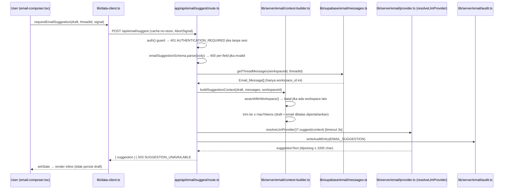
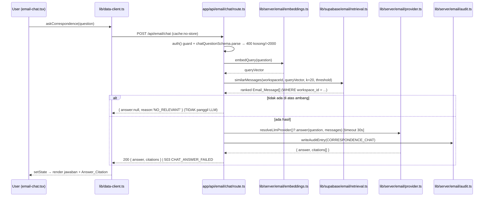

# Design Document — Email Assistant

## Overview

Fitur **Email Assistant** menambahkan dua kemampuan AI berbasis email ke VSS Project Management:

1. **Email_Suggestion** — saran teks inline (ala Copilot) saat pengguna menyusun/membalas email.
   Saran tidak pernah dikirim otomatis dan tidak pernah mempersist draft dengan sendirinya.
2. **Correspondence_Chat** — tanya-jawab bahasa natural atas riwayat korespondensi (RAG) dengan
   rujukan (`Answer_Citation`) ke email sumber.

Desain ini mengikuti arsitektur data satu arah repo tanpa pengecualian:

```
komponen 'use client'
  → @/lib/data-client (satu-satunya pintu masuk data UI)
    → fetch('/api/email/...', { cache: 'no-store' })
      → app/api/email/**/route.ts   (guard auth sendiri + Zod + enforce invariant workspace)
        → lib/server/email/*  & lib/supabase/email/*   (semua 'import server-only')
          → Postgres (Supabase) / pgvector
```

Karena repo **belum punya integrasi email sama sekali**, desain ini menetapkan lingkup increment
pertama secara konservatif dan menandai mana yang masih butuh konfirmasi pengguna
(lihat bagian "Pemetaan Open Decisions"). Prinsip yang dipegang:

- Isolasi workspace ditegakkan **di route handler (server)**, bukan hanya di browser — karena
  pemanggilan langsung ke endpoint dapat melewati validator browser (celah yang didokumentasikan di
  steering `pitfalls`).
- LLM diakses hanya dari modul `server-only`; kunci API tidak pernah masuk bundel browser.
- Setiap pembacaan `Correspondence_Store` difilter `workspace_id` dengan slug `default`
  (`getEventApiContext()`), konsisten dengan single-tenant repo.

### Catatan penting soal abstraksi LLM yang sudah ada

Steering `tech`/`pitfalls` menyebut Gemini (`gemini-3.5-flash-lite`) di-hardcode di beberapa tempat.
**Kode yang berjalan saat ini sudah lebih maju dari deskripsi itu:** `lib/server/extraction/config.ts`
+ `lib/server/extraction/llm/provider.ts` sudah menyediakan abstraksi provider berbasis environment
(`LLM_PROVIDER`, `LLM_API_KEY`, `LLM_MODEL`) dengan adapter `CLAUDE | DEEPSEEK | SUMOPOD` dan helper
`resolveLlmProvider()` / `configuredLlmProvider()`. Desain ini **menggunakan ulang pola itu** daripada
menambahkan jalur Gemini terpisah, sehingga konstanta model terpusat di satu tempat dan fitur email
otomatis mengikuti provider yang sama. Ini menjawab OD-3 dengan pondasi yang sudah ada di repo.

## Architecture

### Lapisan dan modul baru

| Lapisan | Modul baru | Tanggung jawab |
|---|---|---|
| UI (route) | `app/(dashboard)/email/page.tsx` | Halaman fitur, `'use client'`, dua tab (Composer + Chat) |
| UI (komponen) | `components/email-composer.tsx`, `components/email-thread-context.tsx`, `components/email-inline-suggestion.tsx`, `components/email-chat.tsx`, `components/email-citation-list.tsx`, `components/llm-external-badge.tsx` | Primitif fitur, kebab-case |
| Data boundary | tambahan fungsi di `lib/data-client.ts` | `list*/get*/save*` + `requestEmailSuggestion`, `askCorrespondence`, `getEmailAssistantCapabilities` |
| Route handlers | `app/api/email/threads/[threadId]/route.ts`, `app/api/email/drafts/route.ts`, `app/api/email/suggest/route.ts`, `app/api/email/chat/route.ts`, `app/api/email/ingest/route.ts`, `app/api/email/capabilities/route.ts` | Guard auth, Zod, enforce isolasi workspace, panggil server modules |
| Server (logic) | `lib/server/email/suggestion-service.ts`, `lib/server/email/chat-service.ts`, `lib/server/email/ingestion-service.ts`, `lib/server/email/context-builder.ts`, `lib/server/email/embeddings.ts`, `lib/server/email/provider.ts`, `lib/server/email/config.ts`, `lib/server/email/errors.ts`, `lib/server/email/route-failure.ts`, `lib/server/email/audit.ts` | `'import server-only'`; orkestrasi LLM + retrieval + audit |
| Server (storage) | `lib/supabase/email/threads.ts`, `lib/supabase/email/messages.ts`, `lib/supabase/email/drafts.ts`, `lib/supabase/email/retrieval.ts` | `'import server-only'`; query Postgres + pgvector, selalu filter `workspace_id` |
| Domain | `domain/email/types.ts`, `domain/email/validation.ts` | Tipe entitas storage-agnostic + Zod + validator invariant `Validation<T>` |
| DB | `supabase/migrations/<ts>_email_assistant.sql` | `email_threads`, `email_messages` (+ pgvector), `email_drafts`, `llm_audit_log` |

Aturan impor yang dijaga: `app/**` (kecuali `app/api/**`) dan `components/**` **tidak** mengimpor
`@/lib/supabase/*`, `@supabase/supabase-js`, maupun SDK/kunci LLM — hanya `@/lib/data-client`.

### Diagram alur data — Email_Suggestion



### Diagram alur data — Correspondence_Chat (RAG)



## Components and Interfaces

### Route handlers

Semua route menetapkan `export const runtime = 'nodejs'` dan `export const dynamic = 'force-dynamic'`,
memakai `getEventApiContext()` di dalam `try`, dan `return emailRouteFailure(error)` di `catch`.
`emailRouteFailure` (lihat Error Handling) adalah varian `extractionRouteFailure` untuk kode error
email. Otorisasi increment pertama: **setiap pengguna terautentikasi dalam workspace** boleh memakai
fitur (OD-6, butuh konfirmasi); guard di-inline di tiap handler, tidak ada `middleware.ts`.

```ts
// app/api/email/suggest/route.ts (inti)
export async function POST(request: Request) {
  try {
    const { workspaceId } = await getEventApiContext()            // 401 jika tanpa sesi
    const input = emailSuggestionSchema.parse(await request.json()) // 400 per-field
    if (!resolveEmailProvider()) {
      return NextResponse.json(
        { error: SUGGESTION_LLM_UNAVAILABLE_MESSAGE, code: 'LLM_NOT_CONFIGURED' },
        { status: 503 },
      )
    }
    const suggestion = await generateSuggestion(workspaceId, input) // enforce isolasi + trim + call
    return NextResponse.json({ suggestion })
  } catch (error) {
    return emailRouteFailure(error)
  }
}
```

| Endpoint | Method | Bentuk |
|---|---|---|
| `/api/email/capabilities` | GET | `{ llmAvailable: boolean }` — visibilitas config LLM untuk menonaktifkan fitur (R2.11, R4.9) |
| `/api/email/threads/[threadId]` | GET | Konteks thread untuk composer; 404 `THREAD_NOT_FOUND` jika di luar workspace (R1.6) |
| `/api/email/drafts` | POST | Simpan draft (`compose + save draft`, OD-7). Tidak ada outbound send. |
| `/api/email/suggest` | POST | Email_Suggestion. Mendukung pembatalan via `AbortSignal` dari client (R2.4). |
| `/api/email/chat` | POST | Correspondence_Chat (RAG). |
| `/api/email/ingest` | POST | Penyerapan Email_Message (increment pertama: unggah `.eml`/`.mbox`, OD-1). |

### Modul `lib/server/email/*` (server-only)

- `provider.ts` — `resolveEmailProvider()` membungkus `resolveLlmProvider()` repo dan mengekspos dua
  operasi: `suggest(context): Promise<string>` (latensi rendah) dan
  `answer(question, messages): Promise<{ answer: string; citations: Citation[] }>` (konteks panjang,
  RAG). Satu abstraksi, satu konstanta model (OD-3). Tidak mengimplementasikan LLM dari nol.
- `config.ts` — `EMAIL_SUGGESTION_TIMEOUT_MS = 3_000`, `EMAIL_CHAT_TIMEOUT_MS = 30_000`,
  `SUGGESTION_MAX_CHARS = 1000`, `CONTEXT_MAX_TOKENS = Number(process.env.EMAIL_CONTEXT_MAX_TOKENS) || 8000`,
  `CHAT_MAX_MESSAGES = 20`, `RETRIEVAL_THRESHOLD = Number(process.env.EMAIL_RETRIEVAL_THRESHOLD) || 0.75`,
  `MAX_MESSAGE_BODY_SIZE = 10 * 1024 * 1024`. Menggunakan ulang `MAX_DOCUMENT_SIZE` jika ingin satu
  sumber; desain memilih konstanta email terpisah bernilai sama agar niat terbaca jelas.
- `context-builder.ts` — `buildSuggestionContext(draft, messages, workspaceId)`: memanggil validator
  `assertMessagesInWorkspace` (invariant), lalu memangkas konteks (R3.4/R3.5): draft + email yang
  dibalas selalu dipertahankan; email lain dipangkas dari yang paling lama.
- `embeddings.ts` — `embedMessage(body)` dan `embedQuery(question)` → vektor. Provider embedding
  mengikuti `LLM_PROVIDER` bila mendukung embedding; jika tidak, fallback ke Postgres full-text
  (OD-4, hybrid).
- `ingestion-service.ts` — parse `.eml`/`.mbox` → `Email_Message`, persist (upsert by `message_id`),
  lalu index. Persist-first seperti pola `extract-document`: jika index gagal, email ditandai
  `indexed=false` dan store tetap konsisten (R5.5/R5.6).
- `audit.ts` — `writeAuditEntry({ userId, workspaceId, operation })` ke `llm_audit_log` (R6.3).
- `errors.ts`, `route-failure.ts` — lihat Error Handling.

### Modul `lib/supabase/email/*` (server-only)

- `threads.ts` — `getThread(workspaceId, threadId)`, `listThreads(workspaceId)`. 404 bila thread
  bukan milik workspace.
- `messages.ts` — `getThreadMessages(workspaceId, threadId)`, `upsertMessage(workspaceId, message)`.
- `drafts.ts` — `saveDraft(workspaceId, draft)` (upsert by id).
- `retrieval.ts` — `similarMessages(workspaceId, queryVector, k, threshold)`: query pgvector
  **selalu** dengan `WHERE workspace_id = $1` + `ORDER BY embedding <=> $2 LIMIT k`, menyaring skor di
  bawah ambang di server (R4.1/R4.7).

### Fungsi `lib/data-client.ts` (client boundary)

Mengikuti pola `fetch(..., { cache: 'no-store' })` yang sudah ada:

```ts
export async function getEmailAssistantCapabilities(): Promise<{ llmAvailable: boolean }> { /* GET */ }
export async function getEmailThread(threadId: string): Promise<EmailThreadView> { /* GET 404-aware */ }
export async function saveEmailDraft(draft: EmailDraftInput): Promise<EmailDraft> { /* POST */ }
export async function requestEmailSuggestion(
  input: EmailSuggestionInput, signal?: AbortSignal,
): Promise<{ suggestion: string }> { /* POST, meneruskan signal untuk R2.4 */ }
export async function askCorrespondence(
  question: string,
): Promise<CorrespondenceAnswer> { /* POST */ }
```

Setelah mutasi (`saveEmailDraft`, pengiriman pertanyaan), komponen memanggil ulang `get*`/`list*`
lalu `setState` — tidak ada `revalidatePath`/`router.refresh()`.

### Domain (`domain/email/`)

`types.ts` berisi tipe entitas murni (tanpa `Blob`/`File`/tipe Supabase). `validation.ts` memisah
dua gaya sesuai konvensi: Zod untuk input batas API, validator tulis-tangan `Validation<T>` untuk
invariant bisnis (dipanggil **dari route handler**, bukan hanya data-client).

### React components

- `email-composer.tsx` — area teks editable (R1.1/R1.3), debounce 500ms untuk memicu
  `requestEmailSuggestion` (R2.1/R2.2), membatalkan request sebelumnya via `AbortController` (R2.4),
  menampilkan saran inline dengan gaya berbeda (R2.3) + penanda screen reader (R7.7), menyisipkan di
  posisi kursor saat diterima (R2.5), membuang saat diabaikan/mengetik (R2.6). Tidak pernah mengirim
  atau mempersist karena saran dihasilkan (R2.8).
- `email-chat.tsx` — input pertanyaan + daftar jawaban, memakai `PageSkeleton` +
  `finishLoadingAfterMinimum` saat memuat (R7.4), merender `email-citation-list.tsx` (R4.2).
- `llm-external-badge.tsx` — penanda permanen "isi email dikirim ke layanan eksternal" pada kedua
  antarmuka (R6.4).
- Styling pakai kelas bersama `app/globals.css` (`.card`, `.btn-primary`, `.input`, `.label`),
  primitif `components/ui/`, ikon `lucide-react`. Aksesibilitas: `aria-label` Indonesia non-kosong,
  `focus-visible`, hormati `prefers-reduced-motion` (R7.6).

### Toast bersama (menghapus duplikasi)

Steering mewajibkan feedback toast per mutasi via event `vss:toast` yang didengar `AppShell`. Saat ini
helper `toast()` disalin di banyak komponen dan **belum ada** helper bersama. Desain ini membuat satu
helper bersama dan memakainya dari semua komponen email:

```ts
// lib/toast.ts
export function toast(message: string, tone: 'success' | 'error') {
  if (typeof window === 'undefined') return
  window.dispatchEvent(new CustomEvent('vss:toast', { detail: { message, tone } }))
}
```

Komponen email `import { toast } from '@/lib/toast'` — tidak menyalin ulang helper.

### Navigasi

Tambah entri di `links` pada `components/layout.tsx`:
`{ href: '/email', label: 'Email', icon: Mail }` (ikon `lucide-react`). Increment pertama dirilis
sebagai fitur aktif (tanpa `available: false`); jika pengguna ingin menyembunyikan dulu, set
`available: false` agar merender `components/coming-soon.tsx`. **Chat dan composer satu halaman dengan
tab** (OD-8) agar badge eksternal LLM dan kapabilitas provider dibagikan satu kali.

## Data Models

### TypeScript domain types (`domain/email/types.ts`)

```ts
export type EmailAddress = { name: string | null; address: string }

export type EmailMessage = {
  id: string                 // crypto.randomUUID() di server saat ingest
  messageId: string          // RFC Message-ID; kunci dedup per workspace (R5.3)
  threadId: string
  from: EmailAddress
  to: EmailAddress[]
  cc: EmailAddress[]
  subject: string
  sentAt: string             // ISO-8601 UTC
  body: string               // ≤ 10 MB (R5.1)
  indexed: boolean           // false jika embedding gagal (R5.6)
  createdAt: string
  updatedAt: string
}

export type EmailThread = {
  id: string
  subject: string
  messageCount: number
  lastMessageAt: string
  createdAt: string
  updatedAt: string
}

export type EmailDraft = {
  id: string
  threadId: string | null    // null = email baru, bukan balasan
  body: string               // 0..50_000 char (R1.3/R1.7)
  createdAt: string
  updatedAt: string
}

export type Citation = { messageId: string; subject: string; sentAt: string }
export type CorrespondenceAnswer =
  | { answer: string; citations: Citation[] }
  | { answer: null; reason: 'NO_RELEVANT' }

export type LlmOperation = 'EMAIL_SUGGESTION' | 'CORRESPONDENCE_CHAT'
```

### Zod schemas (`domain/email/validation.ts`)

```ts
import { z } from 'zod'
import { fromIssues, issue, ok, type Validation } from '@/domain/shared/validation'

export const emailDraftSchema = z.object({
  id: z.string().uuid('Gunakan ID yang valid.'),
  threadId: z.string().uuid('Gunakan ID yang valid.').nullable(),
  body: z.string().max(50_000, 'Draft email tidak boleh melebihi 50.000 karakter.'), // R1.7
}).strict()

export const emailSuggestionSchema = z.object({
  threadId: z.string().uuid('Gunakan ID yang valid.').nullable(),
  draft: z.string().min(1, 'Draft wajib berisi minimal 1 karakter.').max(50_000,
    'Draft email tidak boleh melebihi 50.000 karakter.'),               // R2.1/R2.2
  cursor: z.number().int().min(0),
}).strict()

export const chatQuestionSchema = z.object({
  question: z.string().trim()
    .min(1, 'Pertanyaan wajib diisi.')                                   // R4.10
    .max(2_000, 'Pertanyaan tidak boleh melebihi 2.000 karakter.'),      // R4.11
}).strict()

// Invariant bisnis (dipanggil DI ROUTE HANDLER, bukan hanya di browser) — R3.2/R3.3, R6.1/R6.2.
export function assertMessagesInWorkspace(
  workspaceId: string, messages: { id: string; workspaceId: string }[],
): Validation<true> {
  const offenders = messages.filter((m) => m.workspaceId !== workspaceId)
  return fromIssues(
    offenders.map((m) => issue('context', 'Konteks tidak berada dalam workspace pengguna.')),
    true as const,
  )
}
```

### SQL migration sketch (`supabase/migrations/<ts>_email_assistant.sql`)

Dedikasi migrasi dipilih (OD-2/OD-4) karena retrieval butuh kolom vektor dan filter server-side —
di luar kemampuan proxy `operational-records` yang generik. Mengikuti konvensi repo: komentar
*kenapa* di awal, idempoten, `enable row level security` + `revoke all ... from anon, authenticated`,
FK `workspace_id` `on delete cascade`, index `(workspace_id, ...)`.

```sql
-- Email Assistant: korespondensi email + retrieval pgvector + audit LLM. Server-only; browser
-- tidak pernah mendapat akses tabel (RLS + revoke). Dedicated karena butuh vektor & filter server.
create extension if not exists vector;

create table if not exists public.email_threads (
  workspace_id uuid not null references public.workspaces(id) on delete cascade,
  id text not null,
  payload jsonb not null,
  subject text,
  last_message_at timestamptz,
  created_at timestamptz not null default now(),
  updated_at timestamptz not null default now(),
  primary key (workspace_id, id)
);

create table if not exists public.email_messages (
  workspace_id uuid not null references public.workspaces(id) on delete cascade,
  id text not null,
  thread_id text not null,
  message_id text not null,            -- RFC Message-ID; dedup per workspace
  payload jsonb not null,              -- EmailMessage utuh, field camelCase
  sent_at timestamptz,
  indexed boolean not null default false,
  embedding vector(1536),              -- OD-4; dimensi menyesuaikan model embedding provider
  body_tsv tsvector,                   -- fallback/hybrid full-text
  created_at timestamptz not null default now(),
  updated_at timestamptz not null default now(),
  primary key (workspace_id, id),
  unique (workspace_id, message_id)    -- menegakkan idempotent ingestion (R5.3) di level DB
);
create index if not exists email_messages_workspace_thread_idx
  on public.email_messages (workspace_id, thread_id, sent_at desc);
create index if not exists email_messages_embedding_idx
  on public.email_messages using ivfflat (embedding vector_cosine_ops) with (lists = 100);
create index if not exists email_messages_tsv_idx
  on public.email_messages using gin (body_tsv);

create table if not exists public.email_drafts (
  workspace_id uuid not null references public.workspaces(id) on delete cascade,
  id text not null,
  payload jsonb not null,
  created_at timestamptz not null default now(),
  updated_at timestamptz not null default now(),
  primary key (workspace_id, id)
);

-- Audit pemanggilan LLM atas isi email (R6.3). TIDAK menyimpan kunci API atau isi email.
create table if not exists public.llm_audit_log (
  workspace_id uuid not null references public.workspaces(id) on delete cascade,
  id uuid primary key default gen_random_uuid(),
  user_id uuid not null references public.app_users(id) on delete cascade,
  operation text not null check (operation in ('EMAIL_SUGGESTION', 'CORRESPONDENCE_CHAT')),
  invoked_at timestamptz not null default now(),   -- UTC presisi milidetik
  created_at timestamptz not null default now()
);
create index if not exists llm_audit_log_workspace_idx
  on public.llm_audit_log (workspace_id, invoked_at desc);

alter table public.email_threads  enable row level security;
alter table public.email_messages enable row level security;
alter table public.email_drafts   enable row level security;
alter table public.llm_audit_log  enable row level security;
revoke all on table public.email_threads, public.email_messages,
  public.email_drafts, public.llm_audit_log from anon, authenticated;
```

`email_threads` dan `email_drafts` adalah agregat sederhana yang **boleh** didaftarkan di
`operationalTables` (dan `collectionTable` di `data-client`) untuk pembacaan generik, tetapi
`email_messages` dan operasi chat/suggest tetap lewat route khusus karena retrieval + isolasi
workspace harus ditegakkan server-side.

## Error Handling

`lib/server/email/errors.ts` mendefinisikan `EmailAssistantError` dengan `status` + `code`
(meniru `DocumentExtractionError`), dan `lib/server/email/route-failure.ts` memetakan error ke
respons — persis pola `extractionRouteFailure` (ZodError → 400 pesan per-field; error khusus →
status+code; `'Autentikasi diperlukan.'` → 401 `AUTHENTICATION_REQUIRED`; sisanya → `eventApiFailure`).

| Kondisi | Status | `code` | Pesan (Indonesia) | Requirement |
|---|---|---|---|---|
| Tanpa sesi | 401 | `AUTHENTICATION_REQUIRED` | `Autentikasi diperlukan.` | R1.5, R2.12, R4.8 |
| Thread di luar workspace | 404 | `THREAD_NOT_FOUND` | `Thread email tidak ditemukan.` | R1.6 |
| Zod invalid (draft/suggest) | 400 | `VALIDATION_ERROR` | pesan per-field | R3.6 |
| Pertanyaan kosong | 400 | `VALIDATION_ERROR` | `Pertanyaan wajib diisi.` | R4.10 |
| Pertanyaan > 2000 char | 400 | `VALIDATION_ERROR` | `Pertanyaan tidak boleh melebihi 2.000 karakter.` | R4.11 |
| Draft > 50.000 char | 400 | `DRAFT_TOO_LARGE` | `Draft email tidak boleh melebihi 50.000 karakter.` | R1.7 |
| Konteks lintas-workspace | 400 | `CROSS_WORKSPACE_CONTEXT` | `Konteks tidak berada dalam workspace pengguna.` | R3.3, R6.2 |
| LLM tak dikonfigurasi (suggest) | 503 | `LLM_NOT_CONFIGURED` | `Saran email tidak tersedia karena belum ada penyedia LLM yang dikonfigurasi.` | R2.11 |
| LLM tak dikonfigurasi (chat) | 503 | `LLM_NOT_CONFIGURED` | `Chat korespondensi tidak tersedia karena belum ada penyedia LLM yang dikonfigurasi.` | R4.9 |
| Suggest gagal/timeout | 503 | `SUGGESTION_UNAVAILABLE` | layanan saran sedang tidak tersedia | R3.7 |
| Chat timeout/galat/kosong | 503 | `CHAT_ANSWER_FAILED` | `Gagal menghasilkan jawaban. Silakan coba lagi.` | R4.5, R4.6 |
| Ingest tak terjangkau/tak terurai | 503 | `INGEST_FAILED` | indikasi gagal serap | R5.7 |

Perilaku UI non-modal untuk saran: galat LLM saran menampilkan teks non-modal yang hilang ≤ 5 detik
dengan `Saran email tidak tersedia saat ini.` (R2.10); timeout/pembatalan tidak memunculkan modal
(R2.9). Konteks lintas-workspace membatalkan panggilan LLM **sebelum** memanggil provider dan draft
dipertahankan (R3.3/R6.2).

## Correctness Properties

*Sebuah properti adalah karakteristik atau perilaku yang harus selalu benar di seluruh eksekusi
valid sistem — pernyataan formal tentang apa yang seharusnya dilakukan sistem, menjembatani
spesifikasi yang dapat dibaca manusia dengan jaminan kebenaran yang dapat diverifikasi mesin.*

Prework klasifikasi acceptance criteria dilakukan dengan tool `prework`; properti di bawah adalah
hasil konsolidasi (redundansi dihilangkan). Properti ini menyasar logika murni di `domain/email/`
dan `lib/server/email/context-builder.ts` + `embeddings`/`retrieval` yang diuji dengan mock store,
karena di situlah perilaku bervariasi berarti terhadap input. Kriteria yang bersifat UI
(inline rendering, toast, fokus) dan integrasi LLM/Supabase diuji sebagai contoh/integrasi, bukan
properti.

### Property 1: Isolasi workspace pada konteks saran

*Untuk setiap* himpunan `Email_Message` dengan `workspace_id` campuran dan `CurrentUser.workspaceId`
sembarang, `assertMessagesInWorkspace` mengembalikan `ok` **jika dan hanya jika** tidak ada pesan
yang `workspace_id`-nya berbeda; bila ada, hasilnya `fail` dan pembangunan konteks dibatalkan.

**Validates: Requirements 3.2, 3.3, 6.1, 6.2**

### Property 2: Konteks tidak pernah memuat pesan workspace lain

*Untuk setiap* query retrieval dengan `workspaceId` dan vektor sembarang, seluruh `Email_Message`
yang dikembalikan `similarMessages` memiliki `workspace_id` sama dengan `workspaceId`.

**Validates: Requirements 4.1, 4.7, 5.8, 5.9**

### Property 3: Pemangkasan konteks mempertahankan minimum dan menghormati batas

*Untuk setiap* draft, email yang dibalas, dan daftar email tambahan sembarang, hasil
`buildSuggestionContext` selalu menyertakan draft dan email yang dibalas; dan **jika** gabungan
keduanya masih ≤ batas token, total konteks berada pada atau di bawah batas; email tambahan yang
dibuang selalu yang paling lama lebih dulu.

**Validates: Requirements 3.4, 3.5**

### Property 4: Penyerapan idempoten terhadap message-id

*Untuk setiap* `Email_Message` dengan `message_id` tertentu, menyerapnya dua kali atau lebih pada
`workspace_id` yang sama menghasilkan tepat satu baris di `Correspondence_Store` (entri diperbarui,
bukan diduplikasi).

**Validates: Requirements 5.3**

### Property 5: Potong panjang saran

*Untuk setiap* teks saran keluaran LLM sembarang, saran yang disajikan memiliki panjang ≤ 1000
karakter (dipotong bila melebihi).

**Validates: Requirements 2.7**

### Property 6: Tanpa sitasi tidak ada jawaban; dan setiap jawaban bersitasi

*Untuk setiap* pertanyaan, bila retrieval tidak menemukan email di atas ambang relevansi maka sistem
mengembalikan status "tidak relevan" tanpa memanggil LLM; dan bila jawaban dihasilkan, jawaban itu
membawa minimal satu `Answer_Citation` yang setiap `messageId`-nya berasal dari himpunan email yang
terambil.

**Validates: Requirements 4.1, 4.2, 4.3**

### Property 7: Draft tidak pernah terkirim/terpersist otomatis

*Untuk setiap* urutan operasi saran (minta, tampilkan, terima, abaikan), tidak ada operasi yang
menghasilkan pengiriman email maupun persist draft; persist/penyimpanan hanya terjadi akibat tindakan
simpan/kirim eksplisit `CurrentUser`.

**Validates: Requirements 1.4, 2.8**

### Property 8: Konsistensi store saat index gagal

*Untuk setiap* `Email_Message` yang persist-nya berhasil tetapi pembangunan index-nya gagal, pesan
tetap ada di `Correspondence_Store` dengan `indexed = false` dan tidak ada entri Retrieval_Index
parsial; dan bila persist gagal, tidak ada entri index sama sekali.

**Validates: Requirements 5.5, 5.6**

## Testing Strategy

Pendekatan ganda: **unit/property tests** untuk logika murni + **route-level tests** untuk guard,
Zod, dan isolasi. Property-based testing diterapkan hanya pada bagian yang punya properti universal
(validasi, pemangkasan konteks, retrieval berfilter, idempotensi) — bukan pada rendering UI, toast,
atau pemanggilan LLM/Supabase nyata (gunakan contoh/integrasi/mok).

### Property-based tests (file baru, WAJIB didaftarkan ke `domain:test`)

Library: gunakan `fast-check` dengan `bun:test` (`import { expect, test } from 'bun:test'`), minimum
**100 iterasi** per properti. Tag komentar tiap test:
`// Feature: email-assistant, Property N: <teks properti>`.

| File test | Properti |
|---|---|
| `domain/email/validation.test.ts` | Property 1 (invariant workspace), Property 5 (potong saran bila diletakkan sebagai util murni) |
| `lib/server/email/context-builder.test.ts` | Property 3 (pemangkasan konteks) |
| `lib/server/email/retrieval.test.ts` | Property 2 (filter workspace, dengan store in-memory mock) |
| `lib/server/email/ingestion-service.test.ts` | Property 4 (idempotensi), Property 8 (konsistensi index) dengan store mock |
| `lib/server/email/chat-service.test.ts` | Property 6 (no-citation-no-answer; sitasi ⊆ terambil) dengan provider mock |

> Catatan wajib (steering `tech`): file `*.test.ts` baru **tidak** otomatis berjalan. Tambahkan tiap
> path di atas ke script `domain:test` pada `package.json`, atau test diam-diam tak pernah dieksekusi.
> Jalankan `npx tsc --noEmit` + `npm run domain:test`, dan `npm run build` karena menyentuh route/komponen.

### Unit/contoh (example-based)

- `email-composer` debounce 500ms, pembatalan `AbortController` (R2.4), penyisipan di kursor (R2.5),
  pembuangan saat mengetik (R2.6) — diuji sebagai contoh interaksi (bukan properti).
- Mapping error → status/code (tabel Error Handling) sebagai contoh per baris.

### Route-level (harus diuji; repo belum punya harness route)

Walau repo belum punya test route handler, perilaku berikut **harus** diverifikasi (minimal manual
atau harness baru): guard 401 tanpa sesi tanpa memanggil LLM/retrieval (R1.5/R2.12/R4.8/R4.12/R2.13);
404 thread lintas-workspace (R1.6); pembatalan panggilan LLM saat konteks lintas-workspace (R3.3);
tidak menyimpan jawaban parsial saat timeout (R4.5/R4.6); audit tercatat tanpa kunci API (R6.3);
tidak ada variabel `NEXT_PUBLIC_` untuk kredensial (R6.5).

### Property 7 (draft tak terkirim otomatis)

Diuji sebagai properti di level service/komponen murni bila memungkinkan; jika memerlukan simulasi
interaksi UI, turunkan ke contoh berbasis state machine composer. Yang dijamin: tidak ada jalur kode
`send`/`persist` yang dipanggil dari alur saran.

## Pemetaan Open Decisions dan Butuh Konfirmasi

| OD | Keputusan desain | Status |
|---|---|---|
| **OD-1** Email_Source | Increment pertama: **unggah manual `.eml`/`.mbox`** via `POST /api/email/ingest`. Alasan: repo belum punya integrasi email; OAuth (Gmail/Graph) menambah scope env + sinkronisasi besar. IMAP worker dijadikan increment berikutnya. | Direkomendasikan; **butuh konfirmasi** sumber final |
| **OD-2** Correspondence_Store | Migrasi dedikasi `email_threads`, `email_messages` (hibrida `payload` + kolom promosi), `email_drafts`. `email_messages` tidak lewat proxy generik karena butuh vektor + filter. | Diputuskan |
| **OD-3** LLM_Provider | Gunakan ulang abstraksi provider repo (`resolveLlmProvider`), satu abstraksi email dengan dua operasi (`suggest`/`answer`), konstanta model terpusat. Catatan: kode repo nyata sudah provider-agnostic (bukan Gemini hardcode seperti steering). | Diputuskan; **butuh konfirmasi** model/akun untuk chat konteks panjang |
| **OD-4** Retrieval_Index | pgvector di Supabase (+ `body_tsv` full-text sebagai fallback/hybrid), embedding saat ingest, query difilter `workspace_id`. | Diputuskan; dimensi vektor menyesuaikan model embedding (**butuh konfirmasi**) |
| **OD-5** Privasi | Isi email dikirim ke LLM eksternal: ditampilkan badge permanen (`llm-external-badge.tsx`) + `llm_audit_log`. Redaksi/retensi/on-prem belum dilingkupi. | Diputuskan minimum; **butuh persetujuan kebijakan data** |
| **OD-6** Otorisasi | Semua pengguna terautentikasi dalam workspace boleh memakai fitur; guard di tiap route handler (repo hanya menegakkan `isAdmin`, gap G-1). | **Butuh konfirmasi** apakah dibatasi peran |
| **OD-7** Outbound | Increment pertama: **compose + simpan draft saja**, tanpa SMTP/API keluar. Outbound = pekerjaan lanjutan. | Diputuskan untuk increment ini |
| **OD-8** Rute/nav | Rute `/email` di `app/(dashboard)/email`, entri nav di `components/layout.tsx`. **Satu halaman, dua tab** (Composer + Chat). | Diputuskan |

Jika ada gap teridentifikasi saat review, desain ini dapat kembali ke fase klarifikasi requirements —
khususnya untuk OD-1, OD-5, dan OD-6 yang menyentuh kebijakan dan sumber data eksternal.
