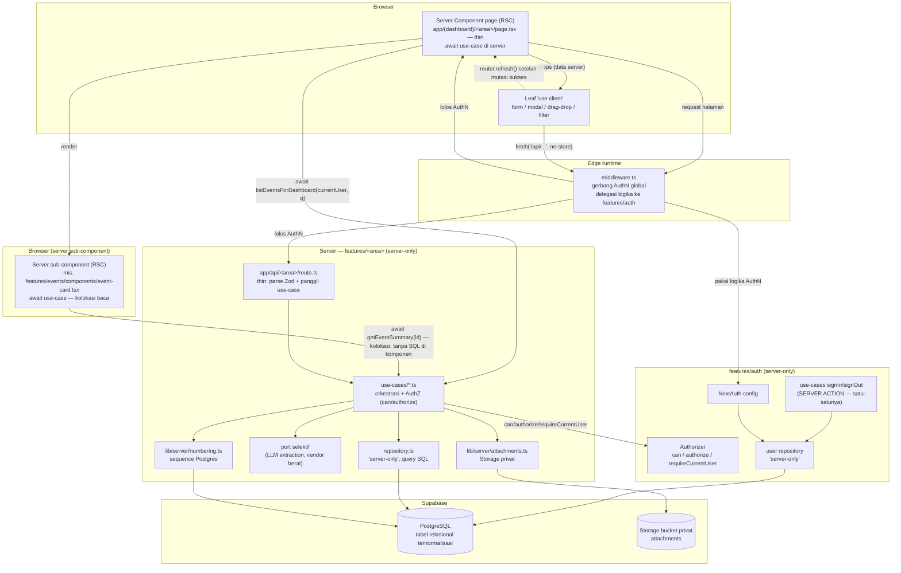

# Design Document: VSS Redesign — Foundation + Event Domain

## Overview

Dokumen ini adalah desain **to-be** untuk membangun ulang (ground-up redesign) workspace operasional
VSS — sistem internal freight-forwarding untuk kargo pameran MICE di Indonesia. Build pertama
(MVP/"garage") sudah selesai didemokan; tim kini membangun ulang demi maintainability. Spec ini
mencakup dua hal: **fondasi lintas-domain** yang menjadi dasar seluruh sistem, dan **domain Event**
sebagai domain pertama yang dibangun di atas fondasi tersebut.

Fondasi menetapkan arsitektur akses data satu arah, skema relasional yang dinormalisasi, lapisan
otentikasi/otorisasi sisi server, generator penomoran aman-transaksi, konvensi lampiran, serta
kontrak error dan validasi. Domain Event memvalidasi fondasi dengan membangun entitas nyata di
atasnya — termasuk perbaikan to-be atas empat temuan yang tercatat di spec as-built lama
(`event-management`): alias yang tidak persisten, pembatalan yang mati, penghapusan cascade tanpa
blokir, dan bypass otorisasi untuk event tanpa PIC.

Domain lain (exhibitor, CIPL, shipment, customs job, ticket, CEISA, LARTAS) **tidak** didesain di
sini. Mereka disebut hanya sebagai konsumen masa depan dari fondasi — pipeline, konvensi, dan titik
ekstensi dirancang agar domain-domain itu pas tanpa menambah mekanisme paralel.

Keputusan arsitektur yang sudah dikunci pengguna diperlakukan sebagai batasan desain (bukan untuk
diperdebatkan ulang) dan dicatat eksplisit di bagian **Design Decisions** di akhir dokumen.

---

# BAGIAN I — HIGH-LEVEL DESIGN

## Architecture

Sistem adalah satu aplikasi Next.js 14 App Router tunggal. Browser tidak pernah menyentuh database.
Pendekatan idiomatik App Router dipakai: **halaman adalah React Server Component (RSC)** yang
`await` data langsung di server; hanya *leaf* interaktif (form, modal, drag-drop, filter yang butuh
state klien) yang `'use client'` dan menerima data hasil-fetch-server lewat props. Baca mengalir di
server; tulis mengalir lewat route handler.



### Prinsip lapisan (tidak boleh dilanggar)

1. **Baca di server, tulis lewat route handler.** Baca di-`await` langsung di server — **tidak ada**
   lapisan fetch klien untuk baca. Permintaan baca boleh diinisiasi **bukan hanya oleh halaman
   top-level**, melainkan juga oleh **sub-komponen Server Component** (mis. sebuah `EventCard`) yang
   butuh datanya sendiri (kolokasi data di tempat pemakaian). Baik halaman maupun sub-komponen server
   melakukannya dengan cara yang sama: `await` sebuah fungsi use-case/repository — **tidak pernah**
   menulis SQL atau `supabase.from(...)` di dalam komponen. Alirannya tetap
   page/komponen → use-case → repository (`server-only`) → Postgres. Mutasi tetap lewat
   `app/api/<area>/route.ts` dipanggil via `fetch` dari leaf `'use client'`; setelah sukses, leaf
   memanggil `router.refresh()` agar RSC memuat ulang data segar.
2. **Hanya Server Component yang boleh `await` data; repository tetap pemilik tunggal query.**
   Komponen apa pun yang `await` data dengan cara ini **wajib** Server Component (tanpa `'use client'`);
   komponen `'use client'` **tidak bisa** `await` query DB. Bagian interaktif dipisah menjadi *leaf*
   klien kecil yang terpisah. Repository tetap **satu-satunya** tempat yang tahu cara meng-query
   database untuk sebuah entitas — ini mencegah duplikasi query dan menjaga komponen tetap buta
   terhadap skema DB.
3. **Route handler tipis.** Route hanya: pasang runtime, parse input dengan Zod, delegasikan ke
   use-case, map hasil ke kontrak error. Tidak ada SQL dan tidak ada aturan bisnis di route.
4. **Use-case memegang orkestrasi + AuthZ + invariant.** Seluruh aturan bisnis (invariant, transisi
   status, otorisasi peran + per-objek) hidup di `features/<area>/use-cases/*` sisi server — bukan di
   browser, bukan di route.
5. **Repository murni I/O.** Modul `features/<area>/repository.ts` ber-`import 'server-only'`,
   memegang satu-satunya akses ke Postgres via service-role client, tidak mengandung aturan bisnis.
6. **Domain murni & bebas-storage.** Tipe + validator `domain/**` tidak pernah memegang
   `Blob`/`File`/tipe storage, HTTP, React, atau Supabase. Lampiran dirujuk lewat id. Ini inti yang
   dapat diuji.
7. **Batas server/klien tetap ditegakkan meski kolokasi.** "Data terikat di komponen" **tidak**
   berarti secret server berada di file komponen klien. Kode yang menyentuh service-role Supabase,
   kunci LLM, atau generasi xlsx **wajib** di file `server-only` (`import 'server-only'`), terpisah
   dari file `'use client'` mana pun — walau sama-sama di dalam folder fitur. Kolokasi = folder fitur
   yang sama; pemisahan server vs klien tetap dijaga penanda `server-only` / `'use client'`. Ini
   aturan bundling/keamanan Next.js, bukan pilihan gaya.

### Mengapa fondasi ini berbeda dari build lama

Build lama membuat halaman dashberisi-data hampir semuanya `'use client'` yang memuat data lewat
`useEffect` + `fetch` + skeleton, menaruh ±70 fungsi untuk semua domain di satu `lib/data-client.ts`
(1702 baris), memvalidasi invariant exhibition **hanya di browser** (bisa dilewati lewat
`/api/operational-records` langsung), dan menyimpan entitas domain utuh di kolom `payload` jsonb
dengan sebagian field dipromosikan ke kolom nyata — menghasilkan dua sumber kebenaran per baris.

Redesign membalik idiom baca: halaman menjadi RSC yang `await` data di server (tak ada
"data menetes" lewat fetch browser, tak ada spinner-UI untuk baca awal). Logika dipecah per-fitur
(vertical slice), invariant + otorisasi pindah ke use-case sisi server, dan penyimpanan menjadi
kolom relasional penuh. Lapisan fetch **baca** klien lama (`lib/data-client`) dengan demikian
sebagian besar dihapus — baca tidak lagi butuh pintu fetch klien.

## Components and Interfaces

_Komponen dan batas modul._

### Strategi batas modul: vertical slice hibrida (tiga rumah)

Build lama: `lib/data-client.ts` tunggal 1702 baris plus halaman monolit `'use client'`. Redesign
memakai **vertical slice hibrida** terilhami HtDP (*How to Design Programs*): rancang datanya dulu,
fungsi mengikuti struktur data; inti murni, efek didorong ke tepi. Proyek bahkan sudah memuat skill
`domain-data-definition` yang merujuk metode HtDP. Ada tiga rumah, masing-masing dengan satu tugas
jelas:

| Rumah | Lokasi | Isi | Server/klien |
|---|---|---|---|
| **Data murni** | `domain/<area>/{types.ts, validation.ts}` | TYPE entitas + validator murni `Validation<T>` (tak throw, kumpulkan semua issue). Tanpa storage, `Blob`/`File`, HTTP, React, Supabase. | — (netral, dapat diuji) |
| **Fitur (slice)** | `features/<area>/{use-cases/*.ts, repository.ts, components/*.tsx, index.ts}` | use-case (orkestrasi + AuthZ + invariant), batas server slice (repository/port), dan komponen fitur — dikolokasi agar tak lompat folder. Di sinilah efek hidup. | campuran: use-case & repository `server-only`; leaf interaktif `'use client'`; subkomponen server biasa |
| **Route tipis** | `app/(dashboard)/<area>/page.tsx` + `app/api/<area>/route.ts` | orkestrator RSC tipis yang merakit dari `features/<area>/`, dan endpoint mutasi tipis. Routing tak bercampur dengan kode domain. | RSC page (server), route handler (server) |

Prinsip HtDP eksplisit: **definisi data lebih dulu**, lalu fungsi mengikuti struktur data; inti murni
di `domain/`, efek (I/O, HTTP, DB, vendor) didorong ke tepi di `features/`. Domain adalah lapisan
yang paling mudah diuji karena tanpa efek.

#### Bentuk folder slice Event (konkret)

```
domain/event/
  types.ts                      ← TYPE + EventListQuery/EventListPage (murni)
  validation.ts                 ← Zod schema + validator invariant Validation<T> (murni)

features/events/
  use-cases/
    list-events-for-dashboard.ts   ← server-only  (baca; dipanggil RSC)
    create-event.ts                ← server-only  (tulis; dipanggil route)
    cancel-event.ts                ← server-only
    delete-event.ts                ← server-only
  repository.ts                    ← server-only  (query SQL)
  components/
    event-form-modal.tsx           ← 'use client'  (leaf interaktif)
    event-filters.tsx              ← 'use client'  (leaf interaktif)
    event-list.tsx                 ← server subcomponent (tanpa 'use client')
    event-card.tsx                 ← server subcomponent — await getEventSummary(id) (kolokasi baca)
  index.ts                         ← re-export batas publik slice

app/(dashboard)/events/page.tsx    ← RSC, thin (await use-case)
app/api/events/route.ts            ← thin mutation endpoint

domain/auth/
  types.ts                      ← User/Session/Role (murni)
  validation.ts                 ← validator kredensial murni + kontrak logika hash (murni)

features/auth/
  use-cases/
    sign-in.ts                     ← server-only  (SERVER ACTION — satu-satunya di sistem)
    sign-out.ts                    ← server-only  (SERVER ACTION)
  authorize.ts                     ← server-only  (can / authorize / requireCurrentUser)
  repository.ts                    ← server-only  (user repository; baca app_users)
  nextauth.ts                      ← server-only  (konfigurasi NextAuth v5)
  index.ts                         ← re-export batas publik slice

middleware.ts                      ← gerbang AuthN global; delegasi ke features/auth
```

**Batas server/klien di dalam slice yang sama ditegakkan keras:** `use-cases/*` dan `repository.ts`
ber-`import 'server-only'` dan tidak boleh diimpor file `'use client'`. Leaf `'use client'`
(`event-form-modal.tsx`, `event-filters.tsx`) tidak boleh mengimpor repository/use-case server;
mereka hanya memanggil `fetch('/api/...')`. Kolokasi folder ≠ bercampurnya bundle.

Fondasi menyediakan modul lintas-domain yang dipakai bersama semua slice:

| Modul fondasi | Tanggung jawab | Penanda |
|---|---|---|
| `lib/server/db.ts` | service-role Supabase client + helper `withWorkspace()` | `server-only` (Server_Only_Module) |
| `features/auth/authorize.ts` | aturan otorisasi peran + per-objek (`can`/`authorize`/`requireCurrentUser`) dipanggil dari use-case. Secara konseptual milik slice `auth` (lihat DD-A12) | `server-only` (Server_Only_Module) |
| `lib/server/numbering.ts` | generator `VSS-XXXXX` berbasis sequence Postgres | `server-only` (Server_Only_Module) |
| `lib/server/attachments.ts` | upload/baca Storage privat, dirujuk lewat id | `server-only` (Server_Only_Module) |
| `lib/server/errors.ts` | `ApiError` + mapper ke kontrak `{ error }` + status | `server-only` |
| `domain/shared/validation.ts` | tipe `Validation<T>` + helper validator invariant | — (murni) |

**Catatan rename:** tipe `Actor` lama kini bernama **`CurrentUser`** (bentuk tetap
`{ id, role, workspaceId }` — identitas terautentikasi yang direduksi ke hal yang dibutuhkan
otorisasi), dan fungsi `requireActor` lama kini bernama **`requireCurrentUser`** demi konsistensi.
Nama `can`/`authorize` dipertahankan.

### Baca via Server Component (kolokasi di tempat pakai), tulis via route handler

Baca di-`await` langsung di server — **tidak ada** lapisan fetch klien untuk baca, jadi lapisan baca
`lib/data/<domain>` lama sebagian besar dihapus. Yang **menginisiasi** baca tidak harus halaman
top-level: sebuah **sub-komponen Server Component** yang butuh datanya sendiri boleh meminta datanya
di tempat (kolokasi). Contoh konkret: `features/events/components/event-card.tsx` adalah Server
Component (tanpa `'use client'`) yang memanggil `getEventSummary(id)` dari use-case; query sebenarnya
tetap tinggal di `repository.ts`. Komponen hanya tahu nama fungsi use-case, bukan skema DB.

**Repository tetap pemilik tunggal query.** Walau baca bisa diinisiasi dari banyak komponen, hanya
`repository.ts` yang tahu cara meng-query database untuk sebuah entitas. Ini mencegah duplikasi query
dan menjaga komponen buta terhadap skema — alirannya tetap
komponen → use-case → repository (`server-only`) → Postgres.

**Aturan keras yang tak bisa ditawar:** komponen apa pun yang `await` data ini **wajib** Server
Component. Komponen `'use client'` **tidak bisa** `await` query DB (dan tidak boleh mengimpor modul
`server-only`); bagian interaktif dipisah menjadi *leaf* klien kecil terpisah yang menerima data
lewat props atau memanggil `fetch('/api/...')` untuk tulis.

```typescript
// features/events/components/event-card.tsx — Server Component (TANPA 'use client')
// Kolokasi: komponen meminta datanya sendiri dengan await use-case; TIDAK ada SQL / supabase.from di sini.
import { getEventSummary } from '@/features/events'   // query hidup di repository, bukan komponen

export async function EventCard({ eventId }: { eventId: string }) {
  const summary = await getEventSummary(eventId)       // await di server
  return (
    <article className="card">
      <h3>{summary.name}</h3>
      {/* tombol/aksi interaktif = leaf 'use client' terpisah, bukan di komponen ini */}
    </article>
  )
}
```

Tulis: mutasi tetap lewat `app/api/<area>/route.ts` dipanggil via `fetch` dari leaf `'use client'`.
Larangan Server Action untuk **mutasi data** dipertahankan (DD-A6) — satu-satunya pengecualian adalah
`signIn`/`signOut` di slice `auth`, karena NextAuth memang bekerja lewat Server Action (lihat DD-A12).

**Revalidasi setelah mutasi:** setelah mutasi sukses, leaf klien memanggil `router.refresh()`
sehingga Server Component memuat ulang data segar dari server. Ini **mengganti** pola lama "refetch
`list*`/`get*` manual lalu `setState`" — perubahan yang disengaja dan benar di bawah Server
Components, karena sumber kebenaran tampilan ada di render server, bukan di state klien.

### Lightweight functional style: panggil repository langsung, port selektif

Use-case memanggil modul repository-nya **langsung** (repository tetap `server-only`, tetap terpisah
dari domain murni). Tidak ada dependency injection port/adapter yang dipaksakan di mana-mana. Pola
port/adapter dipakai **selektif** — hanya untuk integrasi berat/dapat-ditukar (ekstraksi
dokumen/manifest LLM, dan vendor eksternal serupa) agar bisa diuji/di-stub. *Rationale:* DI penuh di
mana-mana menambah indireksi/seremoni yang tak sepadan untuk proyek berbayar pertama; domain tetap
murni dan efek tetap di tepi tanpa itu. Contoh kode (langsung vs port) ada di Low-Level Design.

### Apa arti `import 'server-only'` (sabuk pengaman build-time)

`import 'server-only'` adalah **penjaga waktu-build**, bukan pengubah perilaku runtime. Jika sebuah
file yang ditandai demikian suatu saat **tertarik masuk ke bundle browser** (mis. karena tak sengaja
diimpor komponen `'use client'`), **build GAGAL** — bukannya diam-diam mengirim kode server ke klien.
Penanda ini tidak mengubah apa pun saat program berjalan; ia hanya mencegah inklusi klien yang tidak
disengaja atas file yang menyentuh secret (`SUPABASE_SERVICE_ROLE_KEY`, kunci LLM) atau akses DB.

Definisi: **Server_Only_Module** = setiap file yang menyentuh secret, Supabase service-role, LLM,
atau pembangkitan `xlsx`. Setiap Server_Only_Module **wajib** diawali `import 'server-only'` sebagai
sabuk pengaman. Dengan begitu, meski file server dikolokasi di folder fitur yang sama dengan leaf
`'use client'`, kebocoran secret ke klien tertangkap saat build, bukan di produksi.

## Data Models

_Data model — ER sketch (fondasi + Event)._

```mermaid
erDiagram
  workspaces ||--o{ app_users_workspaces : "scope"
  workspaces ||--o{ venues : "scope"
  workspaces ||--o{ event_organizers : "scope"
  workspaces ||--o{ events : "scope"
  app_users ||--o{ events : "pic / created_by"
  venues ||--o{ events : "venue_id"
  event_organizers ||--o{ events : "event_organizer_id"
  events ||--o| event_cancellations : "0..1"

  workspaces {
    uuid id PK
    text slug UK
  }
  app_users {
    uuid id PK
    text email UK
    text full_name
    text role "STAFF|SUPERVISOR|CUSTOMER_SERVICE|DOCUMENT_ASSISTANT"
    boolean is_active
    text password_hash
  }
  venues {
    uuid id PK
    uuid workspace_id FK
    text legal_name
    text alias_name "nullable"
  }
  event_organizers {
    uuid id PK
    uuid workspace_id FK
    text legal_name
  }
  events {
    uuid id PK
    uuid workspace_id FK
    text name
    text alias "nullable, persisted"
    uuid venue_id FK
    uuid event_organizer_id FK
    uuid pic_id FK
    date starts_on
    date ends_on
    text status "ACTIVE|CANCELLED|ARCHIVED"
    uuid created_by_id FK
    timestamptz created_at
    timestamptz updated_at
  }
  event_cancellations {
    uuid id PK
    uuid workspace_id FK
    uuid event_id FK UK
    text reason
    uuid cancelled_by_id FK
    timestamptz cancelled_at
  }
```

Catatan pipeline: entitas hilir (exhibitor → cipl → cipl_version → shipment → customs_job) akan
menggantung di bawah `events`/`exhibitors` lewat FK pada spec domain berikutnya. Redesign memegang
**satu** pipeline CIPL→Shipment→CustomsJob; tidak ada entitas "Legacy Job" paralel.

Catatan auth: slice `auth` tidak memperkenalkan tabel identitas baru — ia memakai `app_users` yang
**sudah ada** di DDL fondasi (kolom `role` + `password_hash` adalah dasar AuthN/AuthZ). Strategi sesi
adalah **JWT** (NextAuth v5), token membawa `{ id, role, workspaceId }` — yaitu bentuk `CurrentUser`.
Karena sesi JWT, tidak ada tabel `sessions` yang dipersist secara default; bila kelak dibutuhkan
sesi database-backed, tabel `sessions` ditambahkan menggantung ke `app_users` lewat FK `user_id`
(jangan menduplikasi `app_users`). Repository user slice `auth` membaca `app_users` untuk verifikasi
kredensial dan untuk menurunkan `CurrentUser`.

---

# BAGIAN II — LOW-LEVEL DESIGN

## DDL sketches

Konvensi to-be (berbeda dari migrasi lama yang berbasis `like public.venues including all` +
`payload jsonb`): **kolom relasional nyata, FK, dan CHECK**. `jsonb` hanya untuk data yang benar-benar
tak terstruktur. Semua tabel operasional tetap: `workspace_id` dengan `on delete cascade`,
`created_at`/`updated_at`, RLS aktif, dan `revoke all ... from anon, authenticated` (akses hanya lewat
service-role sesudah sesi diverifikasi).

### Fondasi: workspaces, app_users, roles

```sql
-- Mengapa: tenant boundary. Skema multi-tenant, aplikasi single-tenant (slug 'default').
create table if not exists public.workspaces (
  id         uuid primary key default gen_random_uuid(),
  slug       text not null unique check (slug ~ '^[a-z0-9][a-z0-9-]{0,62}$'),
  created_at timestamptz not null default now(),
  updated_at timestamptz not null default now()
);
insert into public.workspaces (slug) values ('default') on conflict (slug) do nothing;

-- Mengapa: identitas + peran yang benar-benar ditegakkan di server (bukan sekadar is_admin).
create table if not exists public.app_users (
  id            uuid primary key default gen_random_uuid(),
  email         text not null unique check (email = lower(email)),
  full_name     text not null check (char_length(trim(full_name)) between 1 and 120),
  role          text not null
                 check (role in ('STAFF','SUPERVISOR','CUSTOMER_SERVICE','DOCUMENT_ASSISTANT')),
  is_active     boolean not null default true,
  password_hash text not null,           -- scrypt self-describing, tidak pernah ke client
  created_at    timestamptz not null default now(),
  updated_at    timestamptz not null default now()
);

-- Keanggotaan workspace (single-tenant hari ini, schema siap multi-tenant).
create table if not exists public.workspace_members (
  workspace_id uuid not null references public.workspaces(id) on delete cascade,
  user_id      uuid not null references public.app_users(id) on delete cascade,
  created_at   timestamptz not null default now(),
  primary key (workspace_id, user_id)
);
```

Catatan: `is_admin` lama dihapus sebagai sumber kebenaran otorisasi. Kapabilitas admin diturunkan dari
`role = 'SUPERVISOR'`. Session JWT membawa `role`, bukan flag boolean.

### Master data: venues, event_organizers

```sql
-- Mengapa: data referensi event, dirujuk lewat id oleh events.
create table if not exists public.venues (
  id           uuid primary key default gen_random_uuid(),
  workspace_id uuid not null references public.workspaces(id) on delete cascade,
  legal_name   text not null check (char_length(trim(legal_name)) between 1 and 200),
  alias_name   text,
  city         text,
  created_at   timestamptz not null default now(),
  updated_at   timestamptz not null default now()
);
create index if not exists venues_workspace_name_idx
  on public.venues (workspace_id, legal_name);

create table if not exists public.event_organizers (
  id           uuid primary key default gen_random_uuid(),
  workspace_id uuid not null references public.workspaces(id) on delete cascade,
  legal_name   text not null check (char_length(trim(legal_name)) between 1 and 200),
  created_at   timestamptz not null default now(),
  updated_at   timestamptz not null default now()
);
create index if not exists event_organizers_workspace_name_idx
  on public.event_organizers (workspace_id, legal_name);
```

### Event + lifecycle (status eksplisit + cancellation record)

```sql
-- Mengapa: pusat operasional. Lifecycle eksplisit (status enum), bukan diturunkan dari
-- ada/tidaknya baris cancellation seperti build lama yang jalur cancel-nya mati.
create table if not exists public.events (
  id                 uuid primary key default gen_random_uuid(),
  workspace_id       uuid not null references public.workspaces(id) on delete cascade,
  name               text not null check (char_length(trim(name)) between 1 and 200),
  alias              text,                               -- TO-BE: dipersist (lihat DD-E1)
  venue_id           uuid not null references public.venues(id) on delete restrict,
  event_organizer_id uuid not null references public.event_organizers(id) on delete restrict,
  pic_id             uuid not null references public.app_users(id) on delete restrict,
  starts_on          date not null,
  ends_on            date not null,
  status             text not null default 'ACTIVE'
                       check (status in ('ACTIVE','CANCELLED','ARCHIVED')),
  created_by_id      uuid not null references public.app_users(id) on delete restrict,
  created_at         timestamptz not null default now(),
  updated_at         timestamptz not null default now(),
  check (ends_on >= starts_on)                           -- invariant tanggal ditegakkan DB
);
create index if not exists events_workspace_starts_idx
  on public.events (workspace_id, starts_on desc);
create index if not exists events_workspace_status_idx
  on public.events (workspace_id, status);
create index if not exists events_venue_dates_idx
  on public.events (workspace_id, venue_id, starts_on, ends_on);  -- untuk deteksi konflik venue

-- pic_id NOT NULL: menghapus bypass "event tanpa PIC bisa dihapus siapa pun" (DD-E4).

-- Mengapa: catatan pembatalan sebagai fakta first-class (siapa, kapan, kenapa),
-- melengkapi status eksplisit di events.status. Jalur cancel HIDUP kembali (DD-E2).
create table if not exists public.event_cancellations (
  id              uuid primary key default gen_random_uuid(),
  workspace_id    uuid not null references public.workspaces(id) on delete cascade,
  event_id        uuid not null unique references public.events(id) on delete cascade,
  reason          text not null check (char_length(trim(reason)) between 1 and 1000),
  cancelled_by_id uuid not null references public.app_users(id) on delete restrict,
  cancelled_at    timestamptz not null default now()
);
```

### Sequence penomoran (aman-transaksi)

```sql
-- Mengapa: ganti read-modify-write counter dari browser yang rawan race di build lama.
-- Sequence Postgres atomik; nomor di-format VSS-XXXXX (minimal 5 digit, boleh lebih).
create sequence if not exists public.customs_job_number_seq as bigint start with 1 increment by 1;
```

### Keamanan baris

```sql
alter table public.venues               enable row level security;
alter table public.event_organizers     enable row level security;
alter table public.events                enable row level security;
alter table public.event_cancellations   enable row level security;
revoke all on table public.venues, public.event_organizers,
                     public.events, public.event_cancellations
  from anon, authenticated;
```

## Key TypeScript signatures

### Otorisasi — peran + per-objek

```typescript
// features/auth/authorize.ts  ('server-only') — Authorizer, konseptual milik slice auth (DD-A12)

export type Role = 'STAFF' | 'SUPERVISOR' | 'CUSTOMER_SERVICE' | 'DOCUMENT_ASSISTANT'

// CurrentUser = identitas terautentikasi yang direduksi ke hal yang dibutuhkan otorisasi.
export type CurrentUser = { id: string; role: Role; workspaceId: string }

// Kapabilitas dideklarasikan, bukan dicek ad-hoc. Satu sumber kebenaran peran→aksi.
export type Capability =
  | 'event:create' | 'event:update' | 'event:cancel' | 'event:delete' | 'event:read'
  | 'reference:create'

// Precondition: sesi sudah diverifikasi middleware; CurrentUser diturunkan dari token.
// Postcondition: mengembalikan CurrentUser bila diizinkan; melempar ApiError 401/403 bila tidak.
export async function requireCurrentUser(): Promise<CurrentUser>

// Aturan peran murni. Postcondition: true iff role boleh melakukan capability.
export function can(role: Role, capability: Capability): boolean

// Gerbang gabungan dipanggil SETIAP route mutasi. Menegakkan peran lebih dulu,
// lalu — bila objectGuard diberi — aturan per-objek (mis. PIC-only untuk delete).
// Postcondition: lolos tanpa efek samping, atau melempar ApiError (403 'Anda tidak...').
export async function authorize(
  currentUser: CurrentUser,
  capability: Capability,
  objectGuard?: () => Promise<boolean>,
): Promise<void>
```

Komposisi peran + per-objek: `authorize` mengecek `can(currentUser.role, capability)` dulu; bila lolos
dan `objectGuard` ada, ia memanggil guard (mis.
`event.pic_id === currentUser.id || currentUser.role === 'SUPERVISOR'`). Kegagalan guard →
`ApiError(403, 'Hanya PIC event atau supervisor yang dapat melakukan tindakan ini.')`.

### Generator penomoran

```typescript
// lib/server/numbering.ts  ('server-only')

// Precondition: dipanggil di dalam konteks request terautentikasi.
// Postcondition: mengembalikan 'VSS-00001' dst., unik & monoton; aman terhadap concurrency
// karena memakai nextval() sequence Postgres (satu round-trip, atomik). Tidak ada baca-ubah-tulis.
export async function nextCustomsJobNumber(): Promise<string>
// implementasi: const n = await db.rpc('nextval_customs_job'); return `VSS-${String(n).padStart(5,'0')}`
```

### Bentuk modul repository

```typescript
// features/events/repository.ts  ('server-only')

import 'server-only'

export type EventRow = {
  id: string; workspaceId: string; name: string; alias: string | null
  venueId: string; eventOrganizerId: string; picId: string
  startsOn: string; endsOn: string; status: 'ACTIVE' | 'CANCELLED' | 'ARCHIVED'
  createdById: string; createdAt: string; updatedAt: string
}

export async function insertEvent(ws: string, input: EventWriteModel): Promise<EventRow>
export async function updateEvent(ws: string, id: string, input: EventWriteModel): Promise<EventRow | null>
export async function findEventById(ws: string, id: string): Promise<EventRow | null>
export async function deleteEvent(ws: string, id: string): Promise<boolean>
export async function insertCancellation(ws: string, c: CancellationWriteModel): Promise<void>
export async function hasDerivedData(ws: string, eventId: string): Promise<boolean> // exhibitor/cipl/dst

// Query daftar dengan filter SERVER-SIDE (bukan baca seluruh tabel lalu filter di browser).
export async function queryEventList(ws: string, q: EventListQuery): Promise<EventListPage>
```

### Bentuk modul use-case (orkestrasi + AuthZ + invariant)

Use-case memanggil repository **langsung** (lightweight functional, bukan DI). AuthZ dipanggil di
sini — bukan di route — karena butuh konteks peran + kepemilikan objek.

```typescript
// features/events/use-cases/list-events-for-dashboard.ts  ('server-only')
import 'server-only'

// Baca: dipanggil langsung oleh Server Component (halaman ATAU sub-komponen seperti EventCard).
// authorize untuk kapabilitas baca.
export async function listEventsForDashboard(
  currentUser: CurrentUser, query: EventListQuery,
): Promise<EventListPage> {
  await authorize(currentUser, 'event:read')
  return repository.queryEventList(currentUser.workspaceId, query)   // panggil repo langsung
}

// Baca terkolokasi: dipanggil oleh EventCard (Server Component). Query tetap di repository.
export async function getEventSummary(
  currentUser: CurrentUser, eventId: string,
): Promise<EventSummary | null> {
  await authorize(currentUser, 'event:read')
  return repository.findEventSummary(currentUser.workspaceId, eventId)
}
```

```typescript
// features/events/use-cases/create-event.ts  ('server-only')
import 'server-only'

// Tulis: dipanggil oleh route handler. Invariant yang butuh state DB ditegakkan di sini.
export async function createEvent(currentUser: CurrentUser, input: EventInput): Promise<EventListItem> {
  await authorize(currentUser, 'event:create')
  const refs = await repository.checkReferences(currentUser.workspaceId, input)  // repo langsung
  const check = validateEventReferences(refs)                                    // domain murni
  if (!check.ok) throw new ApiError(400, check.issues[0].message)
  return repository.insertEvent(currentUser.workspaceId, toWriteModel(input))
}
```

### Port selektif — hanya untuk integrasi berat/dapat-ditukar (contoh LLM)

```typescript
// domain/shared/ports.ts  — kontrak port murni (tanpa implementasi/efek)
export type DocumentExtractor = {
  extract(file: { bytes: Uint8Array; mime: string }): Promise<ExtractedManifest>
}

// features/customs/use-cases/extract-manifest.ts  ('server-only')
import 'server-only'
// Use-case MENERIMA port agar extractor LLM bisa di-stub saat tes. Ini pengecualian
// selektif; use-case Event di atas memanggil repository langsung tanpa port.
export async function extractManifestUseCase(
  currentUser: CurrentUser, file: UploadedFile, extractor: DocumentExtractor,
): Promise<ExtractedManifest> {
  await authorize(currentUser, 'customs:extract')
  return extractor.extract({ bytes: file.bytes, mime: file.mime })
}

// Produksi menyuntik adapter Gemini; tes menyuntik stub deterministik.
// features/customs/adapters/gemini-extractor.ts  ('server-only') implements DocumentExtractor
```

### Zod schema + validator invariant Event

```typescript
// domain/event/validation.ts

import { z } from 'zod'

const dateOnly = z.string().regex(/^\d{4}-\d{2}-\d{2}$/, 'Gunakan tanggal YYYY-MM-DD.')

export const eventInputSchema = z.object({
  name:             z.string().trim().min(1, 'Nama event wajib diisi.'),
  alias:            z.string().trim().max(200).optional(),          // TO-BE: dipersist
  venueId:          z.string().uuid('Venue wajib dipilih.'),
  eventOrganizerId: z.string().uuid('Event organizer wajib dipilih.'),
  picId:            z.string().uuid('PIC wajib dipilih.'),
  startsOn:         dateOnly,
  endsOn:           dateOnly,
}).strict().superRefine((v, ctx) => {
  if (v.endsOn < v.startsOn) {
    ctx.addIssue({ code: z.ZodIssueCode.custom, path: ['endsOn'],
      message: 'Tanggal akhir harus sama dengan atau setelah tanggal mulai.' })
  }
})

export const cancelEventSchema = z.object({
  reason: z.string().trim().min(1, 'Alasan pembatalan wajib diisi.').max(1000),
}).strict()

// Invariant bisnis bergaya pure-validator (tidak throw, kumpulkan semua issue) —
// DITEGAKKAN DI SERVICE SERVER, bukan di browser.
export type ValidationIssue = { path: string; message: string }
export type Validation<T> =
  | { ok: true; value: T }
  | { ok: false; issues: ValidationIssue[] }

// Contoh invariant yang memerlukan state DB (tak bisa dicek Zod sendirian):
// venue & EO & PIC harus ada dalam workspace yang sama.
export function validateEventReferences(ctx: {
  venueExists: boolean; organizerExists: boolean; picExists: boolean
}): Validation<true>
```

### Event-list query dengan filter server-side

```typescript
// domain/event/types.ts
export type EventDisplayStatus = 'soon' | 'ongoing' | 'done'
export type EventLifecycle = 'ACTIVE' | 'CANCELLED' | 'ARCHIVED'

export type EventListQuery = {
  search?: string                              // substring case-insensitive
  lifecycle?: EventLifecycle | 'all'
  display?: EventDisplayStatus | 'active'      // 'active' = bukan CANCELLED & bukan 'done'
  page?: number; pageSize?: number
}

export type EventListPage = {
  rows: EventListItem[]
  total: number
  summary: { totalEvents: number; ongoing: number; exhibitors: number; ciplItems: number }
  attention: AttentionItem[]                   // overlap jadwal, konflik venue, dsb.
}
```

```sql
-- Bentuk query daftar (server-side). status tampilan dihitung dari tanggal,
-- pencarian & filter di SQL, bukan membaca seluruh tabel ke browser.
select e.*, v.legal_name as venue_name, eo.legal_name as organizer_name, u.full_name as pic_name,
  case when current_date < e.starts_on then 'soon'
       when current_date > e.ends_on   then 'done'
       else 'ongoing' end as display_status
from events e
join venues v            on v.id = e.venue_id
join event_organizers eo on eo.id = e.event_organizer_id
join app_users u         on u.id = e.pic_id
where e.workspace_id = $1
  and ($2::text is null or (
        e.name ilike '%'||$2||'%' or e.alias ilike '%'||$2||'%'
     or v.legal_name ilike '%'||$2||'%' or eo.legal_name ilike '%'||$2||'%'
     or u.full_name ilike '%'||$2||'%'))
  and ($3::text is null or e.status = $3)
order by e.starts_on desc
limit $4 offset $5;
```

## Algorithmic pseudocode — use-case mutasi Event dengan otorisasi + invariant server

Alur ini adalah isi `features/events/use-cases/delete-event.ts` (`server-only`). Route handler hanya
mem-parse `eventId` dan memanggil use-case ini; AuthZ + invariant hidup di sini, dekat data.

```pascal
PROCEDURE deleteEventUseCase(currentUser, eventId)
  INPUT: currentUser (hasil requireCurrentUser di route), eventId
  OUTPUT: hasil (void sukses) atau ApiError

  SEQUENCE
    // sesi sudah dijamin middleware (AuthN); currentUser diturunkan dari token di route

    event ← repository.findEventById(currentUser.workspaceId, eventId)
    IF event IS NULL THEN
      THROW ApiError(404, "Event tidak ditemukan.")
    END IF

    // Otorisasi: peran DULU, lalu per-objek. Tidak ada bypass untuk event tanpa PIC
    // (pic_id NOT NULL di skema, jadi kasus itu mustahil secara konstruksi).
    authorize(currentUser, "event:delete", guard = LAMBDA()
      RETURN event.pic_id = currentUser.id OR currentUser.role = "SUPERVISOR")

    // TO-BE: blokir hapus bila ada data turunan (bukan cascade diam-diam).
    IF repository.hasDerivedData(currentUser.workspaceId, eventId) THEN
      THROW ApiError(409,
        "Event tidak dapat dihapus karena masih memiliki exhibitor atau dokumen terkait. "
        + "Batalkan atau arsipkan event sebagai gantinya.")
    END IF

    repository.deleteEvent(currentUser.workspaceId, eventId)
    RETURN void                                   // route memetakan ke noContent(204)
  END SEQUENCE
END PROCEDURE
```

**Precondition:** sesi terverifikasi middleware; `currentUser` diturunkan di route; `eventId` well-formed.
**Postcondition:** event terhapus hanya bila pemohon berwenang DAN tidak ada data turunan; selain itu
tidak ada perubahan state dan `ApiError` yang sesuai dilempar (dipetakan route ke kontrak error).

## Example usage (RSC baca langsung; tulis lewat route + router.refresh)

**Baca — Server Component tipis `await` use-case di server (tanpa fetch klien):**

```typescript
// app/(dashboard)/events/page.tsx — RSC, thin. Tidak ada 'use client', tidak ada useEffect.
import { requireCurrentUser } from '@/features/auth'
import { listEventsForDashboard } from '@/features/events'
import { EventList } from '@/features/events/components/event-list'
import { EventFilters } from '@/features/events/components/event-filters'

export const dynamic = 'force-dynamic'

export default async function EventsPage({
  searchParams,
}: { searchParams: { q?: string; status?: string } }) {
  const currentUser = await requireCurrentUser()                   // sesi sudah dijamin middleware
  const query = { search: searchParams.q, lifecycle: searchParams.status ?? 'all' }
  const data = await listEventsForDashboard(currentUser, query)    // await di server, bukan fetch klien
  return (
    <section>
      <EventFilters />                 {/* leaf 'use client' */}
      <EventList page={data} />        {/* subkomponen server; dapat merender EventCard yang await datanya sendiri */}
    </section>
  )
}
```

**Tulis — leaf `'use client'` memanggil `fetch`, lalu `router.refresh()`:**

```typescript
// features/events/components/event-form-modal.tsx  ('use client') — tak tahu soal Supabase
'use client'
import { useRouter } from 'next/navigation'

export function EventFormModal({ input }: { input: EventInput }) {
  const router = useRouter()
  async function save() {
    const res = await fetch('/api/events', {
      method: 'POST', cache: 'no-store',
      headers: { 'content-type': 'application/json' },
      body: JSON.stringify(input),
    })
    const body = await res.json()
    if (!res.ok) { toast(body.error ?? 'Terjadi kesalahan.', 'error'); return }
    toast('Event tersimpan.', 'success')
    router.refresh()   // RSC re-render dengan data segar; GANTI pola refetch+setState lama
  }
  // ... render form
}
```

**Route handler tetap tipis — parse, delegasi ke use-case, map error:**

```typescript
// app/api/events/route.ts — tipis: parse Zod, delegasikan ke use-case (AuthZ di use-case), map error
export const runtime = 'nodejs'
export const dynamic = 'force-dynamic'

export async function POST(request: Request) {
  try {
    const currentUser = await requireCurrentUser()
    const input = eventInputSchema.parse(await request.json())
    const saved = await createEvent(currentUser, input)   // AuthZ + invariant di use-case
    return NextResponse.json(saved, { status: 201 })
  } catch (error) {
    return toErrorResponse(error)   // ZodError→400, ApiError→status-nya, lainnya→503
  }
}
```

## Correctness properties

- **P1 (batas server/klien):** tidak ada file `'use client'` (di `app/**` non-`api`, `components/**`,
  atau `features/**/components/*`) yang mengimpor modul `server-only` (`features/**/use-cases/*`,
  `features/**/repository.ts`, `lib/server/*`) atau `@supabase/supabase-js`. (Dapat diuji lint/grep.)
- **P2 (otorisasi server):** setiap use-case mutasi memanggil `authorize(...)` sebelum menyentuh
  repository. `∀ uc ∈ mutation use-cases: calls(uc, authorize)`.
- **P3 (invariant server):** mem-bypass UI (POST langsung ke route) tetap menegakkan semua invariant —
  karena validasi + AuthZ ada di use-case server, bukan browser.
- **P4 (penomoran aman-race):** `∀` dua permintaan nomor konkuren → dua nomor berbeda dan monoton.
- **P5 (tidak ada dua sumber kebenaran):** nilai field entitas hanya di kolom relasional; tidak ada
  `payload` jsonb yang menduplikasinya.
- **P6 (lifecycle eksplisit):** `event.status` adalah satu-satunya sumber lifecycle; `CANCELLED`
  selalu memiliki tepat satu baris `event_cancellations` dan sebaliknya.
- **P7 (hapus aman):** `delete` berhasil `⟹` tidak ada data turunan saat itu.

## Error Handling

_Error handling & kontrak._

Bentuk error seragam: `{ error: '<pesan Indonesia>' }`.

| Kondisi | Status | Contoh pesan |
|---|---|---|
| Tanpa sesi | 401 | `Autentikasi diperlukan.` |
| Peran/objek tidak berwenang | 403 | `Hanya PIC event atau supervisor yang dapat melakukan tindakan ini.` |
| Tidak ditemukan | 404 | `Event tidak ditemukan.` |
| Input tidak valid (Zod) | 400 | `Nama event wajib diisi.` |
| Konflik state (mis. hapus dengan data turunan) | 409 | `Event tidak dapat dihapus karena masih memiliki data terkait.` |
| Kegagalan Supabase/vendor | 503 | `Layanan sedang tidak tersedia. Coba lagi.` |

Teks untuk pengguna selalu bahasa Indonesia; identifier, enum, kode, nama tabel/kolom bahasa Inggris
`SCREAMING_SNAKE_CASE`.

## Testing strategy

- **Unit (domain):** Zod schema + validator invariant diuji sebagai fungsi murni (`bun:test`, file
  baru didaftarkan ke `domain:test`).
- **Property-based:** P4 (penomoran konkuren unik/monoton) dan komposisi otorisasi `can(role, cap)`.
  Library: fast-check.
- **Integration (use-case + route handler):** uji bahwa POST langsung ke `/api/events` tetap menolak
  input tak valid dan permintaan tak berwenang (membuktikan P2/P3 — AuthZ + invariant di use-case,
  tidak ada bypass). Use-case yang memakai port (LLM) diuji dengan stub extractor deterministik.
- **Guard arsitektur:** lint/grep untuk P1 (file `'use client'` tak mengimpor `server-only`) dan P5.

## Security considerations

- `SUPABASE_SERVICE_ROLE_KEY`, kunci enkripsi, dan token vendor tidak pernah masuk client bundle;
  modul `lib/server/*` ber-`import 'server-only'`.
- Tidak ada grant ke `anon`/`authenticated`; RLS aktif di semua tabel; akses hanya service-role
  sesudah sesi diverifikasi.
- Password: scrypt dengan salt acak, hash self-describing berversi, `timingSafeEqual`.
- AuthN ditegakkan middleware (gerbang global) dan AuthZ ditegakkan use-case server pada setiap
  mutasi; tidak ada jalur bypass client-only.
- Kolokasi slice tidak melonggarkan batas bundle: file `'use client'` tak pernah mengimpor modul
  `server-only`, jadi service-role key, kunci LLM, dan generator xlsx tak pernah masuk client bundle
  meski berada di folder fitur yang sama.
- `import 'server-only'` adalah penjaga **build-time**: bila sebuah Server_Only_Module (file yang
  menyentuh secret / Supabase service-role / LLM / xlsx) tertarik ke bundle browser, build **gagal**
  alih-alih membocorkan kode server ke klien. Ia tidak mengubah perilaku runtime — hanya mencegah
  inklusi klien yang tidak disengaja.

## Dependencies

Next.js 14 App Router, React 18, TypeScript 5.7 strict, Tailwind 3.4, `@base-ui/react` + CVA, Zod 3,
NextAuth v5 (Credentials + JWT, token membawa `role`), `@supabase/supabase-js` (service-role,
server-only), `fast-check` (property tests). Path alias `@/` dari root repo.

---

# Design Decisions

Setiap keputusan mencatat opsi terpilih dan rationale. Keputusan arsitektur (DD-A*) dikunci pengguna;
keputusan domain Event (DD-E*) adalah perbaikan to-be atas temuan spec as-built.

## Keputusan arsitektur (terkunci)

- **DD-A1 — Pipeline tunggal.** Hanya CIPL→Shipment→CustomsJob yang dibawa. "Legacy Job" tidak
  dilanjutkan sebagai konsep terpisah. *Rationale:* dua pipeline paralel tanpa aturan sinkronisasi
  (gap G-4) adalah sumber kebingungan utama di build lama.
- **DD-A2 — Penyimpanan relasional normal.** Kolom nyata + FK + CHECK; `jsonb` hanya untuk data
  tak terstruktur. Penomoran via sequence Postgres. *Rationale:* pola hibrida `payload` jsonb lama
  menciptakan dua sumber kebenaran per baris; counter baca-ubah-tulis dari browser rawan race.
- **DD-A3 — Validasi & otorisasi sisi server.** Semua invariant dan aturan peran ditegakkan di
  service/route. *Rationale:* build lama memvalidasi invariant hanya di browser, bisa dilewati lewat
  `/api/operational-records` langsung; otorisasi hanya `is_admin`.
- **DD-A4 — Clean cutover.** Skema baru di repo/branch bersih, bukan `/api/v2` di samping `/api/v1`.
  *Rationale:* menghindari dua sistem paralel. **Perangkap yang dihindari:** `domain/v2/` mati di repo
  lama persis anti-pola ini — meta-model yang tidak pernah dipakai runtime.
- **DD-A5 — Port hanya logika domain murni terbukti, ditulis ulang dengan tes:** aturan transisi
  status BC, builder draft CEISA BC 2.3, ekstraksi dokumen/manifest Gemini, cek LARTAS/INSW. Ini
  concern domain masa depan — disebut sebagai logika yang dipertahankan, tidak didesain di sini.
- **DD-A6 — Mutasi lewat route handler, bukan Server Action.** *Rationale:* satu mekanisme mutasi
  tunggal; otorisasi & kontrak error terpusat; konsisten dengan gerbang middleware. **Catatan:** ini
  hanya untuk **tulis DATA**. Baca tidak lagi butuh lapisan fetch klien — halaman/sub-komponen RSC
  `await` use-case langsung di server (lihat DD-A8/DD-A11), sehingga lapisan baca `lib/data/<domain>`
  lama dihapus. **Satu-satunya pengecualian larangan Server Action adalah `signIn`/`signOut`** di
  slice `auth` — bukan mutasi data domain, melainkan mekanisme bawaan NextAuth (lihat DD-A12). Larangan
  ini tetap berlaku penuh untuk semua mutasi data entitas.
- **DD-A8 — Server Components first.** Opsi: (A) halaman `'use client'` dengan
  `useEffect`+`fetch`+skeleton (cara build lama), (B) halaman sebagai React Server Component yang
  `await` data di server, hanya leaf interaktif `'use client'`. **Pilih B.** *Rationale:* lebih
  sedikit round-trip klien, tak ada data "menetes" lewat fetch browser, lebih sedikit UI
  spinner/skeleton untuk baca awal; ini pendekatan idiomatik Next.js 14 App Router.
- **DD-A9 — Vertical slice hibrida (`domain/` murni + `features/` + route tipis), terilhami HtDP.**
  Opsi: (A) layering horizontal per-teknologi (semua tipe di satu tempat, semua query di tempat
  lain), (B) vertical slice tiga rumah. **Pilih B.** *Rationale:* HtDP — rancang datanya dulu, fungsi
  mengikuti struktur data; inti murni di `domain/`, efek di tepi di `features/`, route tetap bersih.
  Kolokasi use-case + repository + komponen dalam satu folder fitur menghindari lompat folder; proyek
  sudah memuat skill `domain-data-definition` yang merujuk HtDP. **Batas keamanan yang dinyatakan
  tegas:** "data terikat di komponen" **tidak** berarti secret server berada di file komponen klien.
  Kode yang menyentuh service-role Supabase, kunci LLM, atau generasi xlsx **wajib** di file
  `server-only`, terpisah dari file `'use client'` mana pun, walau dikolokasi di folder fitur yang
  sama. Kolokasi = folder fitur sama; pemisahan server vs klien tetap ditegakkan penanda
  `server-only` / `'use client'`. Ini aturan bundling/keamanan Next.js, bukan pilihan gaya.
- **DD-A10 — Lightweight functional: panggil repository langsung, port selektif.** Opsi: (A)
  port/adapter + DI di seluruh lapisan, (B) use-case memanggil repository langsung; port hanya untuk
  integrasi berat/dapat-ditukar. **Pilih B.** *Rationale:* DI penuh di mana-mana menambah
  indireksi/seremoni yang tak sepadan untuk proyek berbayar pertama. Domain tetap murni dan efek
  tetap di tepi tanpa DI. Port dipakai selektif untuk ekstraksi dokumen/manifest LLM dan vendor
  eksternal serupa agar bisa diuji/di-stub (lihat contoh di Low-Level Design). Ini melengkapi DD-A5
  (logika domain murni yang dipertahankan) dengan menetapkan *bagaimana* integrasi berat disuntik.
- **DD-A11 — Baca via RSC, tulis via route handler + `router.refresh()`.** Opsi: (A) refetch
  `list*`/`get*` manual lalu `setState` setelah mutasi (cara build lama), (B) RSC `await` baca di
  server; setelah mutasi sukses leaf klien memanggil `router.refresh()` untuk memicu RSC re-render.
  **Pilih B.** *Rationale:* di bawah Server Components, sumber kebenaran tampilan ada di render
  server, bukan state klien; `router.refresh()` memuat ulang data segar dari server tanpa menduplikasi
  logika fetch di klien. Ini mengganti pola refetch+setState lama secara sengaja dan benar.
- **DD-A12 — Auth sebagai slice domain kelas satu (setara Event).** Opsi: (A) perlakukan auth sebagai
  utilitas lintas-domain yang berserakan (`lib/auth`, `auth.ts`, config NextAuth tersebar seperti build
  lama), (B) desain auth sebagai vertical slice penuh, konsisten dengan layout hibrida. **Pilih B.**
  *Rationale:* auth punya data murni, aturan murni, efek I/O, dan konfigurasi — persis bentuk slice
  lain, jadi memperlakukannya setara Event membuat otorisasi dan kredensial punya satu rumah yang jelas.
  Strukturnya:
  - `domain/auth/` — tipe murni (`User`, `Session`, `Role`) + validator kredensial murni + **kontrak
    logika hashing password** (scrypt, hash self-describing berversi, `timingSafeEqual`). Tanpa
    storage/HTTP/React.
  - `features/auth/` — use-case `signIn`/`signOut`, user repository (`server-only`, membaca `app_users`),
    dan konfigurasi NextAuth. **Authorizer** (`can`/`authorize`/`requireCurrentUser`) secara konseptual
    milik slice ini.
  - `middleware.ts` tetap gerbang AuthN global, tetapi **mendelegasikan/memakai** logika dari slice
    `auth` alih-alih memuat logikanya sendiri (lihat DD-A7).
  - Identitas memakai `app_users` yang **sudah ada** di DDL fondasi (tidak diduplikasi); sesi JWT
    membawa bentuk `CurrentUser`.
  **Nuansa penting (pengecualian terhadap DD-A6):** `signIn`/`signOut` adalah **satu-satunya Server
  Action** di sistem, karena NextAuth memang bekerja lewat Server Action. Jadi mekanisme **tulis** slice
  `auth` berbeda dari slice lain yang menulis lewat route handler — ini **diharapkan**, bukan
  pelanggaran DD-A6. DD-A6 melarang Server Action untuk **mutasi data entitas**; auth (sign-in/sign-out)
  bukan mutasi data domain dan merupakan satu-satunya pengecualian yang disengaja.

## Keputusan desain middleware

- **DD-A7 — Perkenalkan `middleware.ts` sebagai gerbang sesi global. REKOMENDASI: ya.**
  Opsi: (A) guard per-route seperti build lama, (B) middleware tunggal. **Pilih B** untuk gating
  sesi (redirect ke `/login`, tolak API tanpa sesi), **tetapi otorisasi peran/per-objek tetap di
  use-case/service**. *Rationale:* build lama tanpa middleware berarti setiap route handler baru bisa
  lupa memasang guard — kelemahan sistemik. Middleware menutup "lupa otentikasi" secara default;
  otorisasi granular tetap dekat data karena bergantung konteks (peran + kepemilikan objek) yang tidak
  tersedia murah di edge. Signature `authorize`/`can`/`requireCurrentUser` dipertahankan, tapi titik
  panggilnya kini di lapisan use-case (bukan route handler gemuk). Jadi: middleware = AuthN gate;
  use-case/service = AuthZ. Logika AuthN/AuthZ ini secara konseptual milik slice `auth` (DD-A12);
  `middleware.ts` memakai/mendelegasikan ke sana alih-alih memuat logikanya sendiri.

## Keputusan to-be domain Event

- **DD-E1 — Alias: persist secara benar.** Opsi: (A) persist, (B) buang dari UI. **Pilih A.** Kolom
  `events.alias` nyata, dimuat & dicari. *Rationale:* alias dipakai pencarian (Req 8); build lama
  menampilkannya tapi selalu menyimpan `null` (temuan T-1) sehingga pencarian alias percuma.
- **DD-E2 — Pembatalan: lifecycle eksplisit + aksi cancel yang hidup.** Opsi: (A) status turunan dari
  ada/tidaknya baris cancellation (cara lama, jalurnya mati), (B) `status` enum eksplisit + record
  `event_cancellations` dengan aksi cancel berfungsi. **Pilih B.** *Rationale:* build lama (T-2)
  menghapus pembuatan cancel tapi masih menurunkan `CANCELLED` dari baris legacy — status basi tanpa
  cara mengubahnya. Status eksplisit + record (alasan, oleh siapa, kapan) memulihkan aksi dan
  memberi jejak audit.
- **DD-E3 — Hapus: blokir bila ada data turunan, sediakan arsip.** Opsi: (A) cascade delete semua
  turunan (cara lama), (B) blokir hapus bila ada turunan + sediakan `ARCHIVED`. **Pilih B.**
  *Rationale:* sistem akan memegang data klien nyata; cascade permanen diam-diam (T-3) berbahaya.
  Hapus hanya untuk event kosong/salah-input; event dengan riwayat di-`ARCHIVED`, bukan dihancurkan.
- **DD-E4 — Otorisasi: peran + per-objek nyata, tanpa bypass legacy.** Opsi: (A) PIC-only dengan
  bypass untuk event tanpa PIC (cara lama), (B) `pic_id` NOT NULL + `authorize` memeriksa peran lalu
  kepemilikan PIC (atau SUPERVISOR). **Pilih B.** *Rationale:* build lama (T-4) membiarkan siapa pun
  menghapus event tanpa PIC. Dengan `pic_id` wajib, kasus bypass mustahil secara konstruksi; supervisor
  tetap bisa menindak sebagai eskalasi.
